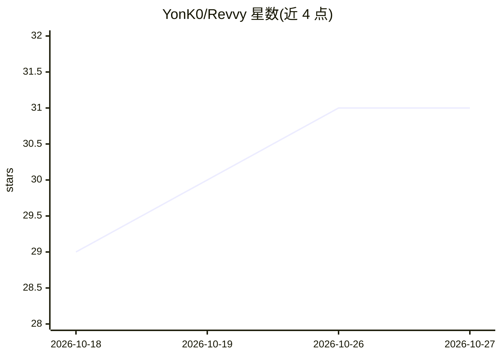

# YonK0/Revvy

⭐ 31 · TypeScript · MIT · 推送 2026-06-23 · [GitHub](https://github.com/YonK0/Revvy) · 个人维护

**VS Code 扩展：用 YAML 团队规则做结构化 AI 代码审查**

面向开发团队的 VS Code 扩展，将 AI 代码审查嵌入编辑器：团队在 YAML 文件中定义一次审查规则（内置 c-embedded、yocto、python 示例配置），对每个 PR/MR 强制执行。支持 GitHub 与 GitLab 多仓库审查（经 MCP）、按 Jira 需求校验代码、生成功能与回归集成测试，发现问题时在 UI 内联标注代码行。AI 后端可用 GitHub Copilot（无需额外 key）、OpenAI GPT-4o 或 Anthropic Claude，带自动回退。提供 Per File 与 All in One 两种审查模式。需 VS Code 1.96.0+ 与 Git。

## 筛选速览

| 维度 | 判定 | 备注 |
|---|---|---|
| AI 角色 | `ai-native` | 本体是模型或模型工具 |
| 许可风险 | `permissive` | MIT |
| 部署形态 | `library` | 以包/库形式分发 |
| 模型依赖 | locked-api |  |
| 硬件要求 | — | 无带数字的原话,不猜 |
| 安装摩擦 | `low` | 无编译、无系统依赖或容器化 |
| 成熟度 | — | 结构信号不足 |

## 能力要点

- YAML 规则配置，团队共享、保存时自动重载
- 经 MCP 单次审查多个 GitHub PR 与 GitLab MR
- 按 Jira 工单需求校验代码并生成集成测试
- AI 后端支持 Copilot/OpenAI/Anthropic 并自动回退

## 适用场景

- 团队统一审查标准，在每个 PR/MR 上强制执行
- 安全关键嵌入式 C/C++ 等领域应用专属规则审查
- 把审查意见连同提示词一键复制给 AI 助手批量修复

## 场景标签

`代码审查` · 领域:编码与开发

## 证据(README 行号)

> L18: Revvy is a VS Code extension that brings structured, AI-powered code review directly into your editor. Instead of g
> L38: > **It works with the AI backend you already have** — GitHub Copilot (no extra key needed), OpenAI GPT-4o, or Anthr

## 星数曲线

2026-10-18 29 → 2026-10-27 31（+2）

---
*卡片 v1 · prompt 1.4 · 生成 2026-10-26 · 置信度 mid · 依据 README sha `54840b7f108d` · [字段定义](../../DATASET.md)*
