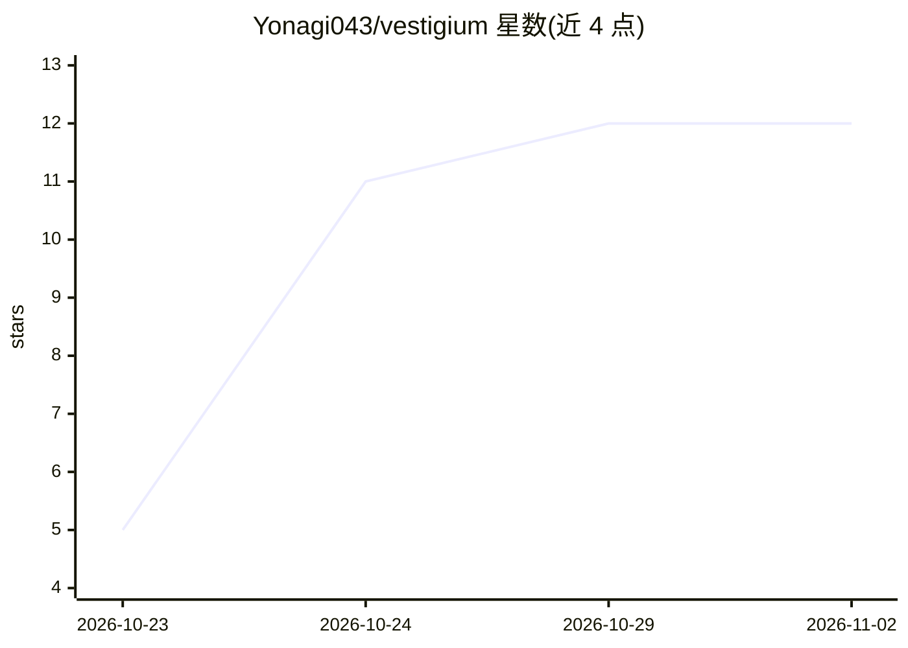

# Yonagi043/vestigium

⭐ 12 · Python · MIT · 推送 2026-10-28 · [GitHub](https://github.com/Yonagi043/vestigium) · 个人维护 · 中文 README

**让 AI agent 按地址读取长 PDF 并引用页码的 MCP 服务器**

面向使用 MCP 客户端（如 Claude Code）的开发者的 MCP 服务器：用 Docling（含 OCR）把 PDF 解析为章节、页、表格、脚注等带地址的文本图，提供 search/read/context/region 等六个 MCP 工具，agent 可按 s12、p45、Note 7 等地址读取片段，回答时附 PDF 页码。索引构建不调用模型、不使用向量数据库，搜索为 BM25 关键词。全部本地运行，仅 agent 读取的片段会发送给其使用的模型。实验性支持中文；未在 Claude Code 之外的客户端做过准确性测试。

## 筛选速览

| 维度 | 判定 | 备注 |
|---|---|---|
| AI 角色 | `ai-ecosystem` | LLM/agent 周边工具 |
| 许可风险 | `permissive` | MIT |
| 部署形态 | `library` | 以包/库形式分发 |
| 模型依赖 | — | README 未给出锁定关系 |
| 硬件要求 | — | 无带数字的原话,不猜 |
| 安装摩擦 | `low` | 无编译、无系统依赖或容器化 |
| 成熟度 | — | 结构信号不足 |

## 能力要点

- Docling 解析 PDF（含 OCR）并生成 s12/p45/tab4/Note 7 等可寻址结构
- 六个 MCP 工具：list_documents/outline/search/read/context/region
- 索引构建无模型调用、无向量数据库，搜索为 BM25 关键词
- 可选 trace 与 rules 工具，记录阅读过程并以规则控制阅读行为

## 适用场景

- 让编程 agent 回答长报告/法规/手册问题时附 PDF 页码引用
- 扫描件或结构复杂 PDF 的按需局部阅读，避免整篇加载
- 在 Claude Code 等 MCP 客户端中核查回答出处

## 场景标签

`文档解析` · 领域:知识与检索

## 证据(README 行号)

> L29: - **A map, not a pile of chunks.** Docling parses the PDF, with OCR for scanned pages. Vestigium then organizes sec
> L120: How it works: a PDF is parsed once by Docling with OCR into a text graph of sections, pages, footnotes, tables and
> L152: - **VS Code (Copilot), Cursor and other MCP clients**: configuration examples are provided. By the protocol they s

## 星数曲线

2026-10-23 5 → 2026-11-02 12（+7）

---
*卡片 v1 · prompt 1.4 · 生成 2026-11-01 · 置信度 high · 依据 README sha `bddaabe9118c` · [字段定义](../../DATASET.md)*
