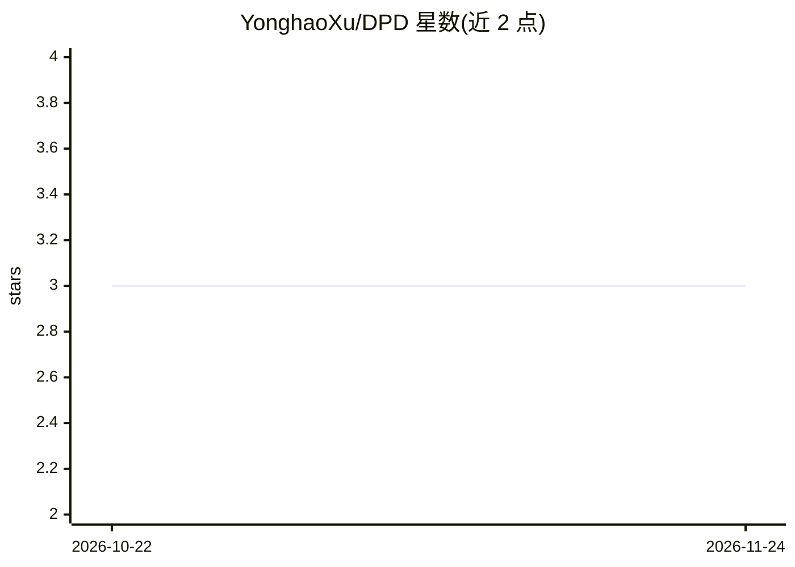

# YonghaoXu/DPD

⭐ 3 · Python · Apache-2.0 · 推送 2026-10-08 · [GitHub](https://github.com/YonghaoXu/DPD) · 组织维护

**遥感数据集蒸馏论文官方实现：扩散模型生成蒸馏数据**

论文《Toward Realistic Remote Sensing Dataset Distillation with Discriminative Prototype-guided Diffusion》的官方实现。流程：为 UCM/AID/NWPU-RESISC45 遥感数据集生成图像-文本元数据；以 Text2Earth 初始化微调 Stable Diffusion 2 的 LoRA；VAE 潜空间聚类提取 IPC 原型并训练潜空间分类器做候选选择；原型引导生成蒸馏数据；提供分类准确率、FID、CLIP Score、类内覆盖率、NN-SSIM 等评估脚本，并附预训练 LoRA 与分类器权重。依赖 diffusers 源码安装与定制 pipeline 文件复制。

## 筛选速览

| 维度 | 判定 | 备注 |
|---|---|---|
| AI 角色 | `ai-native` | 本体是模型或模型工具 |
| 许可风险 | `permissive` | Apache-2.0 |
| 部署形态 | `library` | 以包/库形式分发 |
| 模型依赖 | — | README 未给出锁定关系 |
| 硬件要求 | — | 无带数字的原话,不猜 |
| 安装摩擦 | `low` | 无编译、无系统依赖或容器化 |
| 成熟度 | — | 结构信号不足 |

## 能力要点

- 在 UCM/AID/NWPU-RESISC45 三个遥感数据集上复现蒸馏流程
- Stable Diffusion 2 + LoRA 微调，附预训练 LoRA 权重
- 判别性原型引导的图像生成与潜空间分类器候选选择
- 五类评估脚本：准确率/FID/CLIP Score/覆盖率/NN-SSIM

## 适用场景

- 复现论文的遥感数据集蒸馏实验
- 在少量样本（IPC 5-20）设置下训练分类器
- 评估蒸馏数据集的生成质量与分类有效性

## 场景标签

`图像生成` `微调` · 领域:内容生成

## 证据(README 行号)

> L3: This is the official implementation of the paper **Toward Realistic Remote Sensing Dataset Distillation with Discrim
> L61: Fine-tune `Stable Diffusion 2` (initialized by `Text2Earth`) with LoRA. Replace `UCM` with `AID` or `NWPU` as neede

## 星数曲线

2026-10-22 3 → 2026-11-24 3（+0）

---
*卡片 v1 · prompt 1.4 · 生成 2026-11-22 · 置信度 high · 依据 README sha `f1b33ba53f3b` · [字段定义](../../DATASET.md)*
