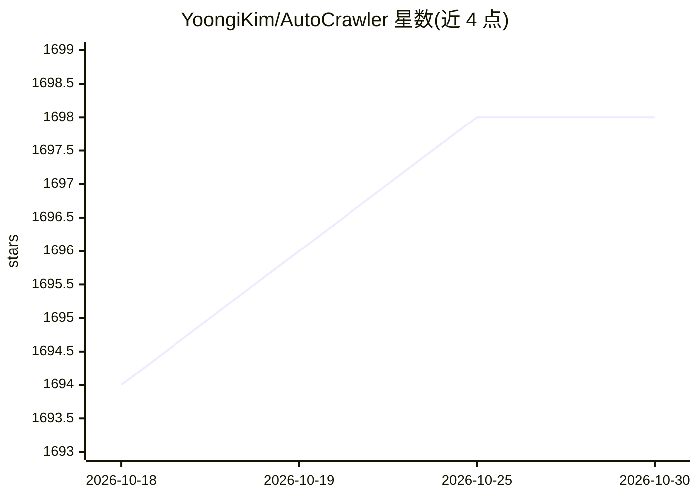

# YoongiKim/AutoCrawler

⭐ 1,698 · Python · Apache-2.0 · 推送 2026-08-30 · [GitHub](https://github.com/YoongiKim/AutoCrawler) · 个人维护

**Google/Naver 多进程图片爬虫，用于构建图像数据集**

基于 Selenium 的命令行图片爬虫：从 keywords.txt 读取关键词，多线程抓取 Google 与 Naver 图片搜索结果，支持原图模式（JPG/GIF/PNG）、人脸过滤、下载数量限制与去重跳过；爬取结束后检测目录间文件数不平衡并提示重下。提供 CAPTCHA 人工解决流程（持久化 Chrome profile 预热）与远程 SSH 服务器运行指引；可通过修改 collectors 目录下文件自定义爬虫，并附 Google/Naver 页面改版后 XPath 修复指南。

## 筛选速览

| 维度 | 判定 | 备注 |
|---|---|---|
| AI 角色 | `ai-ecosystem` | LLM/agent 周边工具 |
| 许可风险 | `permissive` | Apache-2.0 |
| 部署形态 | `library` | 以包/库形式分发 |
| 模型依赖 | — | README 未给出锁定关系 |
| 硬件要求 | — | 无带数字的原话,不猜 |
| 安装摩擦 | `low` | 无编译、无系统依赖或容器化 |
| 成熟度 | — | 结构信号不足 |

## 能力要点

- Google/Naver 多进程图片抓取，关键词文件驱动
- full 模式下载原图（JPG/GIF/PNG）
- 数据不平衡检测（低于均值 50% 的目录提示）
- CAPTCHA 预热 profile 与多线程 profile 副本机制

## 适用场景

- 为深度学习训练批量采集各类别图像数据集
- 通过自定义 collector 扩展或修复目标站点选择器
- 在远程服务器上无 GUI 长时间挂机爬取

## 场景标签

`网页抓取` · 领域:效率与自动化

## 证据(README 行号)

> L2: Google, Naver multiprocess image crawler (High Quality & Speed & Customizable)
> L6: 1. Install Chrome

## 星数曲线

2026-10-18 1,694 → 2026-10-30 1,698（+4）

---
*卡片 v1 · prompt 1.4 · 生成 2026-10-21 · 置信度 mid · 依据 README sha `bae436ebc0f3` · [字段定义](../../DATASET.md)*
