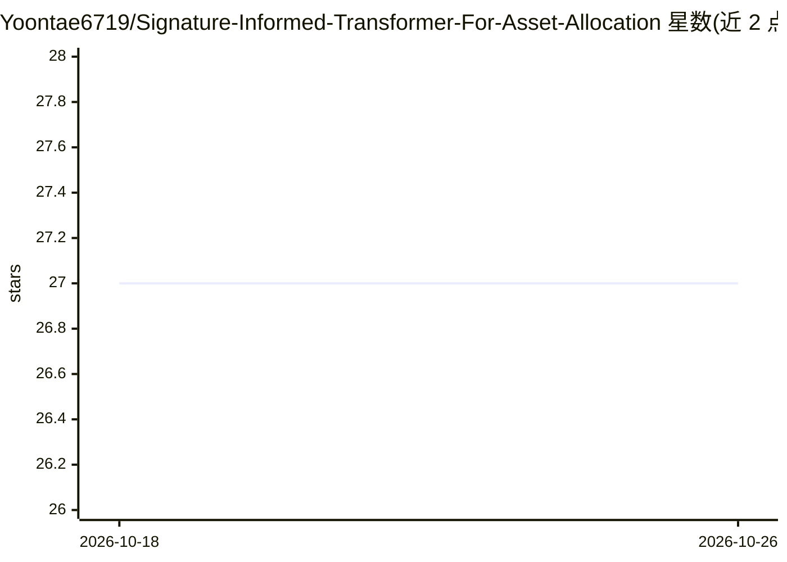

# Yoontae6719/Signature-Informed-Transformer-For-Asset-Allocation

⭐ 27 · Jupyter Notebook · MIT · 推送 2025-11-26 · [GitHub](https://github.com/Yoontae6719/Signature-Informed-Transformer-For-Asset-Allocation) · [官网](https://tsi-yoontae.github.io/#home) · 个人维护

**论文官方 PyTorch 实现：基于路径签名的 Transformer 资产配置**

SIGNATURE-INFORMED TRANSFORMER FOR ASSET ALLOCATION 论文的原始 PyTorch 实现。模型读取最多 50 只资产的日度价格/收益数据，将路径签名与交叉签名特征输入 Transformer，预测收益并经 softmax 温度参数转换为组合权重，考虑交易成本后输出净值曲线、年化收益/波动/Sharpe/CVaR 等指标与持仓记录。数据按时间划分为训练(2000-2016)、验证(2017-2019)、测试(2020-2024)。使用流程为：clone 仓库、pip 安装依赖、运行签名预计算脚本生成缓存，再通过 run.py 或示例 shell 脚本训练评估。要求 Python 3.8+ 与 PyTorch 1.10+。

## 筛选速览

| 维度 | 判定 | 备注 |
|---|---|---|
| AI 角色 | `ai-native` | 本体是模型或模型工具 |
| 许可风险 | `permissive` | MIT |
| 部署形态 | `library` | 以包/库形式分发 |
| 模型依赖 | — | README 未给出锁定关系 |
| 硬件要求 | — | 无带数字的原话,不猜 |
| 安装摩擦 | `low` | 无编译、无系统依赖或容器化 |
| 成熟度 | — | 结构信号不足 |

## 能力要点

- 路径签名/交叉签名特征 + Transformer 的资产配置模型（论文官方实现）
- 预计算脚本生成签名张量缓存以加速训练
- 评估输出净值曲线、Sharpe、CVaR 等指标与持仓 CSV
- 支持资产池规模(30/40/50)、窗口、预测期、温度、交易成本等超参数

## 适用场景

- 复现论文中的资产配置实验
- 在自选资产日度收益数据上训练组合配置模型
- 比较不同资产池规模与超参下的组合表现

## 场景标签

`金融量化` · 领域:学习与行业

## 证据(README 行号)

> L3: This is the origin Pytorch implementation of SIT in the following paper: SIGNATURE-INFORMED TRANSFORMER FOR ASSET AL
> L13: * `run.py` – entry point for training and evaluation. It wraps the experiment class in `exp/` and exposes many hype

## 星数曲线

2026-10-18 27 → 2026-10-26 27（+0）

---
*卡片 v1 · prompt 1.4 · 生成 2026-10-26 · 置信度 high · 依据 README sha `cf4eca407969` · [字段定义](../../DATASET.md)*
