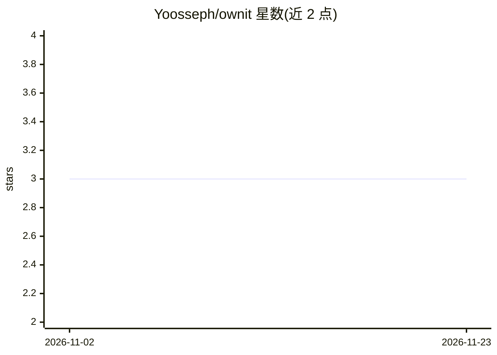

# Yoosseph/ownit

⭐ 3 · TypeScript · MIT · 推送 2026-11-20 · [GitHub](https://github.com/Yoosseph/ownit) · [官网](https://yoosseph.github.io/ownit/) · 组织维护

**git push 后由 LLM 提问的代码理解复盘工具**

Ownit 通过 pre-push 钩子在每次 git push 后发起 1-3 个关于变更的复盘问题（为什么改、怎么实现、下一步），由所选模型生成问题并评分，通过后提交在 GitHub 上标记为 verified，仓库徽章显示已解释的提交比例。默认模型为 Nebius Token Factory 上的 NVIDIA Nemotron，也支持 OpenAI、Claude、DeepSeek 的自有 key；三类模型调用（出题、评分、追问）均在 Cloudflare Worker 上执行，参考答案以加密令牌传递，代码与答案默认不存储。定位为学习工具，不作为作者身份或代码正确性的证明；需要 Node 20+、GitHub App 安装。

## 筛选速览

| 维度 | 判定 | 备注 |
|---|---|---|
| AI 角色 | `ai-native` | 本体是模型或模型工具 |
| 许可风险 | `permissive` | MIT |
| 部署形态 | `desktop` | 安装包/桌面程序 |
| 模型依赖 | locked-api |  |
| 硬件要求 | — | 无带数字的原话,不猜 |
| 安装摩擦 | `low` | 无编译、无系统依赖或容器化 |
| 成熟度 | — | 结构信号不足 |

## 能力要点

- pre-push 钩子触发 1-3 个 why/how/next 复盘问题，可稍后用 ownit interview 补做
- 出题、评分、追问三类模型调用，评分在 temperature 0 运行
- 参考答案以仅服务器可解开的加密令牌传递，代码 diff 用后即弃
- 带防提示注入措施：数据置于标记块，附 live-injection-check 测试脚本

## 适用场景

- 在 AI 编码工作流中保持对自己提交内容的理解
- 团队仓库中标记哪些成员还有未完成的提交复盘
- 用徽章展示仓库中已通过复盘验证的提交比例

## 场景标签

 · 领域:开发者工具/学习

## 证据(README 行号)

> L22: When you run `git push`, Ownit's pre-push hook offers a debrief: why you made the change,
> L58: By default, questions and grades in Ownit come from **NVIDIA Nemotron 3.5 Super** (120B parameters,
> L78: A debrief makes three kinds of model call, all from the Cloudflare Worker

## 星数曲线

2026-11-02 3 → 2026-11-23 3（+0）

---
*卡片 v1 · prompt 1.4 · 生成 2026-11-22 · 置信度 high · 依据 README sha `bce10325275f` · [字段定义](../../DATASET.md)*
