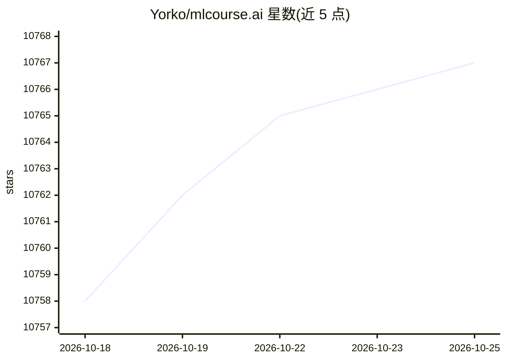

# Yorko/mlcourse.ai

⭐ 10,768 · Python · NOASSERTION · 推送 2026-09-03 · [GitHub](https://github.com/Yorko/mlcourse.ai) · [官网](https://mlcourse.ai) · 个人维护 · 中文 README

**自学模式的开源机器学习课程：讲义、视频与作业**

由 OpenDataScience 社区 Yury Kashnitsky 维护的开放机器学习课程，现为自学模式：按 10 周组织，从 Pandas 到梯度提升，每周给出阅读文章、视频讲座与作业指引；文章有英文、俄文与中文版本，并链接 Kaggle Notebook。提供 10 个演示作业、3 个 Kaggle Inclass 竞赛，另有付费 Bonus Assignments 包（10 个非演示作业与解答，版权归作者，禁止公开分享）。课程主体以 CC BY-NC-SA 4.0 发布，可用 uv 与 Jupyter Book v1 从源码构建站点。

## 筛选速览

| 维度 | 判定 | 备注 |
|---|---|---|
| AI 角色 | `ai-knowledge` | 知识聚合/清单类 |
| 许可风险 | `none` | NOASSERTION |
| 部署形态 | `library` | 以包/库形式分发 |
| 模型依赖 | — | README 未给出锁定关系 |
| 硬件要求 | — | 无带数字的原话,不猜 |
| 安装摩擦 | `low` | 无编译、无系统依赖或容器化 |
| 成熟度 | — | 结构信号不足 |

## 能力要点

- 10 周结构化课程：文章/讲座/作业每周指引
- 文章提供英/俄/中三语版本并配套 Kaggle Notebook
- 10 个演示作业与 3 个 Kaggle Inclass 竞赛
- 可用 uv + Jupyter Book v1 本地构建课程站点

## 适用场景

- 按周自学机器学习理论与实战
- 通过 Kaggle Notebook 在线完成作业练习
- 参加配套 Kaggle Inclass 竞赛检验水平

## 场景标签

`教程课程` · 领域:学习与行业

## 证据(README 行号)

> L9: mlcourse.ai is an open Machine Learning course by OpenDataScience (ods.ai), led by Yury Kashnitsky (yorko), now Staf
> L36: You are guided through 10 weeks of mlcourse.ai. For each week, from Pandas to Gradient Boosting, instructions are g

## 星数曲线

2026-10-18 10,758 → 2026-10-25 10,767（+9）

---
*卡片 v1 · prompt 1.4 · 生成 2026-10-20 · 置信度 mid · 依据 README sha `8a29ff9d4c46` · [字段定义](../../DATASET.md)*
