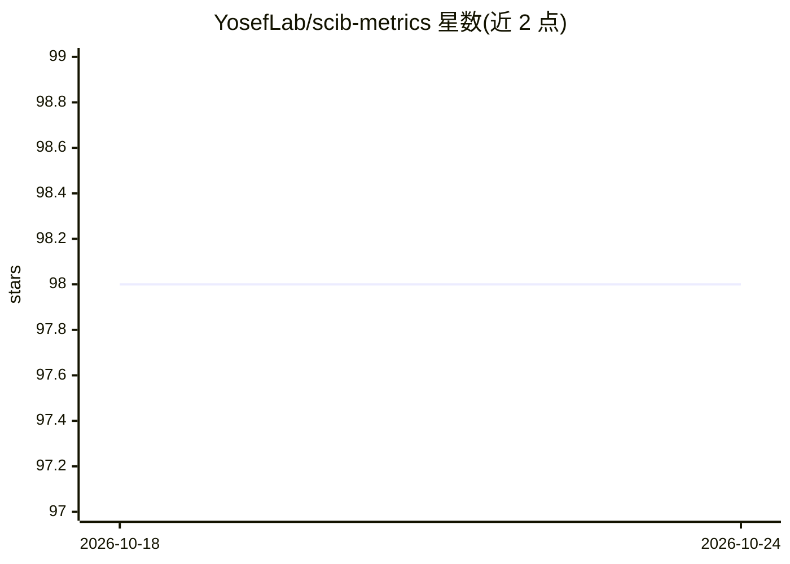

# YosefLab/scib-metrics

⭐ 98 · Python · BSD-3-Clause · 推送 2026-10-20 · [GitHub](https://github.com/YosefLab/scib-metrics) · [官网](https://scib-metrics.readthedocs.io/) · 组织维护

**单细胞数据整合方法的基准评测指标库**

提供单细胞组学数据整合方法性能评测指标的纯 Python 实现，尽可能使用 JAX 进行 jit 编译与硬件加速。目前正移植 scIB 论文中的指标，与原始实现的偏差有文档记录，但指标值不可与 scIB 仓库的结果直接比较。面向生物信息学开发者，需 Python 3.12+，GPU 加速需另行安装对应版本的 JAX。

## 筛选速览

| 维度 | 判定 | 备注 |
|---|---|---|
| AI 角色 | `ai-ecosystem` | LLM/agent 周边工具 |
| 许可风险 | `permissive` | BSD-3-Clause |
| 部署形态 | `library` | 以包/库形式分发 |
| 模型依赖 | — | README 未给出锁定关系 |
| 硬件要求 | — | 无带数字的原话,不猜 |
| 安装摩擦 | `low` | 无编译、无系统依赖或容器化 |
| 成熟度 | — | 结构信号不足 |

## 能力要点

- scIB 论文指标的纯 Python 移植实现
- 基于 JAX 的 jit 编译与硬件加速
- 与原始实现的偏差有文档记录

## 适用场景

- 评测单细胞数据整合方法的性能
- 在整合流程中计算基准指标
- 用 GPU 加速批量计算评测指标

## 场景标签

`模型评测` · 领域:评测与运维

## 证据(README 行号)

> L12: Accelerated and Python-only metrics for benchmarking single-cell integration outputs.
> L14: This package contains implementations of metrics for evaluating the performance of single-cell omics data integrati

## 星数曲线

2026-10-18 98 → 2026-10-24 98（+0）

---
*卡片 v1 · prompt 1.4 · 生成 2026-10-23 · 置信度 high · 依据 README sha `5f64e0ad0aef` · [字段定义](../../DATASET.md)*
