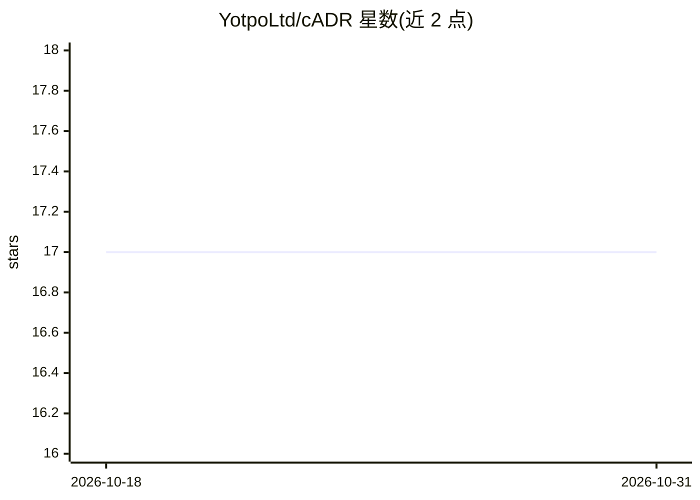

# YotpoLtd/cADR

⭐ 17 · TypeScript · MIT · 推送 2026-04-16 · [GitHub](https://github.com/YotpoLtd/cADR) · [官网](https://www.npmjs.com/package/cadr-cli) · 组织维护

**随编码自动生成架构决策记录（ADR）的 CLI 工具**

面向开发者的 npm CLI 工具：在 Git 工作流中用 LLM（OpenAI/Gemini）分析暂存区、未提交变更或提交区间，检测架构级显著变更并按 MADR 模板自动生成含上下文、决策驱动因素、备选方案、结论与后果的 Markdown ADR，顺序编号保存。通过 cadr.yaml 配置 provider 与模型，支持忽略模式；不阻塞提交。另可作为 Vercel AI Agent Skill 供 Claude Code、Cursor、Windsurf 等 coding agent 调用。

## 筛选速览

| 维度 | 判定 | 备注 |
|---|---|---|
| AI 角色 | `ai-native` | 本体是模型或模型工具 |
| 许可风险 | `permissive` | MIT |
| 部署形态 | `library` | 以包/库形式分发 |
| 模型依赖 | — | README 未给出锁定关系 |
| 硬件要求 | — | 无带数字的原话,不猜 |
| 安装摩擦 | `low` | 无编译、无系统依赖或容器化 |
| 成熟度 | — | 结构信号不足 |

## 能力要点

- LLM 分析 Git 变更，检测架构级显著变更
- 按 MADR 模板生成含备选方案与后果的 ADR
- 支持 OpenAI 与 Gemini 全系 chat 模型
- 以 AI Agent Skill 形式接入 coding agent

## 适用场景

- 提交代码时自动记录架构决策，保持文档与代码同步
- 让 Claude Code/Cursor 等 agent 编码时同步产出 ADR
- 团队沉淀架构决策的上下文与备选方案

## 场景标签

`AI 写作` · 领域:内容生成

## 证据(README 行号)

> L10: Stop losing track of important architectural decisions. cADR analyzes your code changes with LLMs and generates com
> L46: - 🤖 **LLM-Powered Analysis** - OpenAI and Gemini integration to detect architecturally significant changes

## 星数曲线

2026-10-18 17 → 2026-10-31 17（+0）

---
*卡片 v1 · prompt 1.4 · 生成 2026-10-29 · 置信度 high · 依据 README sha `e7a982d8b366` · [字段定义](../../DATASET.md)*
