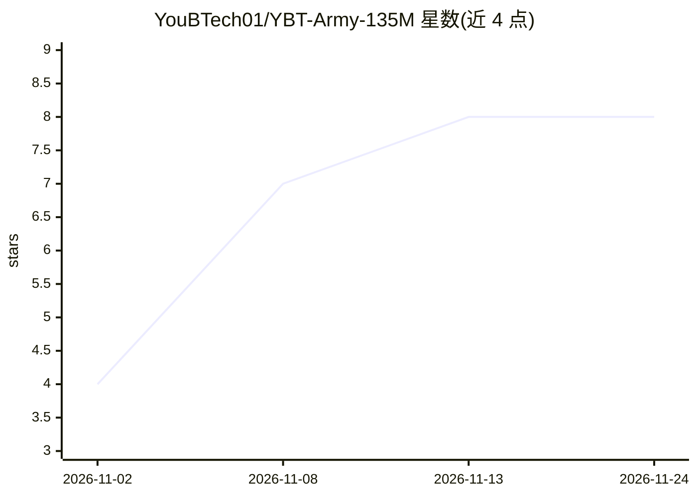

# YouBTech01/YBT-Army-135M

⭐ 8 · Python · NOASSERTION · 推送 2026-10-30 · [GitHub](https://github.com/YouBTech01/YBT-Army-135M) · 个人维护

**离线运行的 135M 小型语言模型助手，带聊天界面**

包含一个 134.5M 参数的 transformer 模型权重与 Streamlit 聊天界面：安装后在本地离线生成回复，支持流式输出、会话保存、暗色主题与四种回复风格切换；算术、问候与身份类问题由内置规则直接回答，不经过模型。权重通过 Git LFS 随仓库分发，README 说明 20 题自测准确率非公开基准，并声明自由文本数学与长推理能力有限。

## 筛选速览

| 维度 | 判定 | 备注 |
|---|---|---|
| AI 角色 | `ai-native` | 本体是模型或模型工具 |
| 许可风险 | `none` | NOASSERTION |
| 部署形态 | `library` | 以包/库形式分发 |
| 模型依赖 | — | README 未给出锁定关系 |
| 硬件要求 | — | 无带数字的原话,不猜 |
| 安装摩擦 | `low` | 无编译、无系统依赖或容器化 |
| 成熟度 | — | 结构信号不足 |

## 能力要点

- 134.5M 参数，FP16 权重 274 MB，可离线运行于普通笔记本
- Streamlit 聊天界面，支持流式输出与会话本地保存
- 算术/问候/身份问题由内置规则直接回答
- 回复风格可切换 Balanced/Concise/Detailed/Hinglish

## 适用场景

- 无网络环境下在本地运行聊天助手
- 学习小型 transformer 模型的完整结构与应用
- 在低配设备上体验本地语言模型生成

## 场景标签

`聊天机器人` · 领域:对话与助手

## 证据(README 行号)

> L3:  A compact 135M-parameter AI model with a clean chat UI.
> L18: - **Private and offline.** After the one-time install, the model runs on your own machine. No account, no API key, 
> L59: 2. The tokenizer turns it into tokens, and a 30-layer transformer predicts the next token again and again.

## 星数曲线

2026-11-02 4 → 2026-11-24 8（+4）

---
*卡片 v1 · prompt 1.4 · 生成 2026-11-20 · 置信度 mid · 依据 README sha `6f376a1fb7e7` · [字段定义](../../DATASET.md)*
