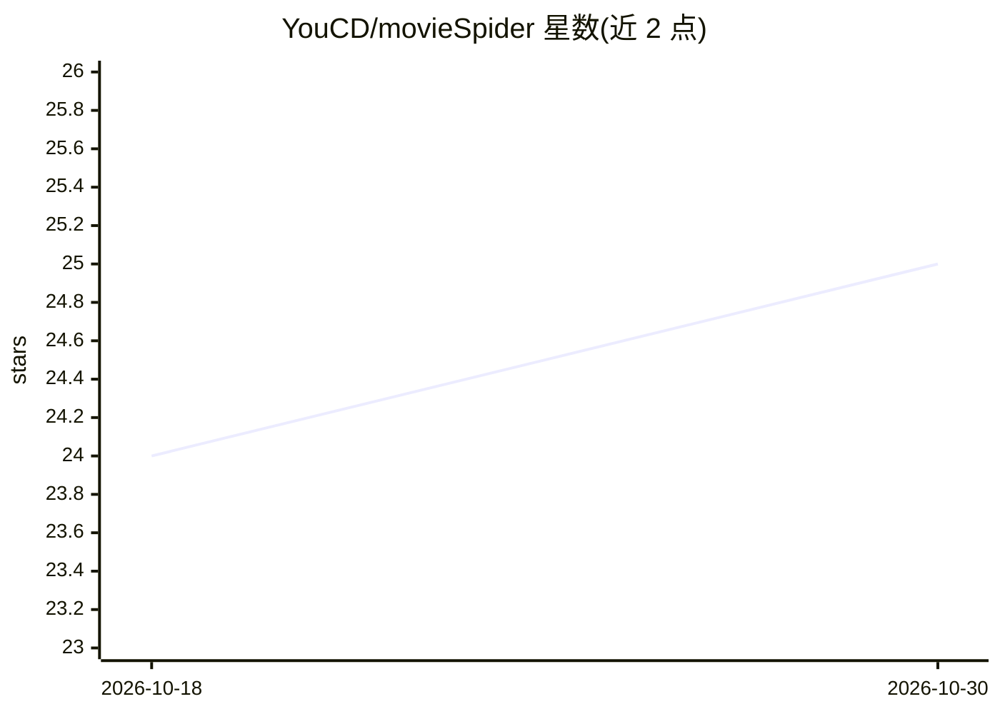

# YouCD/movieSpider

⭐ 25 · Go · 推送 2026-09-29 · [GitHub](https://github.com/YouCD/movieSpider) · 个人维护 · 中文 README

**自动爬取电影种子并通过 Aria2 下载的爬虫工具**

Go 编写的电影自动化下载爬虫：从十余个 Torrent 站点（如 eztv、knaben、Yts 等，部分已划线失效）爬取资源，集成 DHT 网络，通过 Aria2 自动下载，并刮取豆瓣电影想看列表。支持 Telegram 通知（下载中/上映/完成）与带白名单的 TG bot 命令。AI 部分为微调 Qwen3-0.6B 模型用于种子名规范化。提供 quickStart 脚本与 systemd 部署方式；字幕自动下载与网页展示为待办项，通知渠道目前仅适配 TG。

## 筛选速览

| 维度 | 判定 | 备注 |
|---|---|---|
| AI 角色 | `ai-enhanced` | 去掉 AI 部分产品仍成立 |
| 许可风险 | `none` | — |
| 部署形态 | `None` |  |
| 模型依赖 | — | README 未给出锁定关系 |
| 硬件要求 | — | 无带数字的原话,不猜 |
| 安装摩擦 | `low` | 无编译、无系统依赖或容器化 |
| 成熟度 | — | 结构信号不足 |

## 能力要点

- 多站点种子自动爬取，集成 DHT 网络
- 通过 Aria2 自动下载，刮取豆瓣想看列表
- Telegram 通知与带白名单的 bot 命令
- 微调 Qwen3-0.6B 模型提高种子名规范化能力

## 适用场景

- 自动追新电影并完成下载
- 通过 Telegram 接收下载与上映通知
- 规范化混乱的种子命名

## 场景标签

`网页抓取` · 领域:效率与自动化

## 证据(README 行号)

> L3: 自动化下载电影的爬虫工具
> L53: * [x] 微调Qwen3-0.6B模型： 提高种子名规范化能力

## 星数曲线

2026-10-18 24 → 2026-10-30 25（+1）

---
*卡片 v1 · prompt 1.4 · 生成 2026-10-27 · 置信度 high · 依据 README sha `22f27f460773` · [字段定义](../../DATASET.md)*
