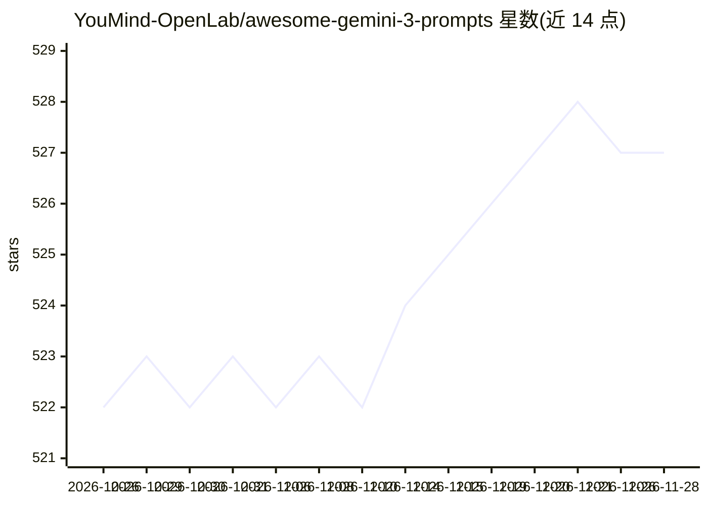

# YouMind-OpenLab/awesome-gemini-3-prompts

⭐ 527 · TypeScript · NOASSERTION · 推送 2026-11-27 · [GitHub](https://github.com/YouMind-OpenLab/awesome-gemini-3-prompts) · [官网](https://youmind.com/gemini-3-prompts) · 组织维护 · 中文 README

**Gemini 3 创意提示词合集：49 条精选 prompt 供复用**

面向 Google Gemini 3 模型的社区提示词策展仓库：收录 49 条来自 Twitter 等来源的 prompt，每条附描述、可复制文本、示例效果图与作者出处，覆盖网页设计、SVG 图标生成、3D 场景等用途。提供 12 种语言版本 README，部分 prompt 使用 Raycast Snippets 动态参数语法以便快速替换变量；另有 youmind.com 网页画廊支持搜索与 AI 一键生成。许可为 CC BY 4.0，prompt 收录出于教育目的并设侵权移除机制。

## 筛选速览

| 维度 | 判定 | 备注 |
|---|---|---|
| AI 角色 | `ai-knowledge` | 知识聚合/清单类 |
| 许可风险 | `none` | NOASSERTION |
| 部署形态 | `None` |  |
| 模型依赖 | — | README 未给出锁定关系 |
| 硬件要求 | — | 无带数字的原话,不猜 |
| 安装摩擦 | `low` | 无编译、无系统依赖或容器化 |
| 成熟度 | — | 结构信号不足 |

## 能力要点

- 收录 49 条 Gemini 3 社区 prompt，附示例图与作者出处
- 部分 prompt 支持 Raycast Snippets 动态参数语法
- 提供 12 种语言版本 README 与网页画廊浏览方式

## 适用场景

- 为 Gemini 3 网页/图标生成任务寻找现成 prompt 模板
- 参考社区 prompt 的写法与结构
- 通过 Raycast 动态参数快速迭代 prompt 变量

## 场景标签

`提示工程` `精选清单` · 领域:Agent 开发

## 证据(README 行号)

> L9: > 🎨 A curated collection of creative prompts for Google's Gemini 3
> L65: |📝 Total Prompts|**49**|
> L69: ## 📋 All Prompts

## 星数曲线

2026-10-26 522 → 2026-11-28 527（+5）

---
*卡片 v1 · prompt 1.4 · 生成 2026-11-28 · 置信度 high · 依据 README sha `04e39ccf34e2` · [字段定义](../../DATASET.md)*
