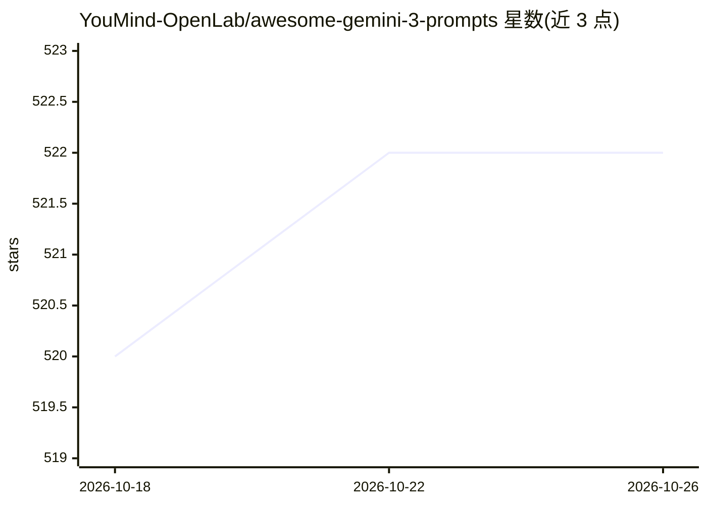

# YouMind-OpenLab/awesome-gemini-3-prompts

⭐ 522 · TypeScript · NOASSERTION · 推送 2026-10-25 · [GitHub](https://github.com/YouMind-OpenLab/awesome-gemini-3-prompts) · [官网](https://youmind.com/gemini-3-prompts) · 组织维护 · 中文 README

**Gemini 3 创意提示词策展清单：49 条多语言提示词配图**

面向 Gemini 3 用户的提示词精选集：从社区（主要是 Twitter 帖子）收集 49 条提示词，覆盖英文、中文、日文等多语言，多为网页/落地页/图标生成等创意开发类任务，每条附描述、示例图片、作者与来源。部分提示词支持 Raycast Snippets 动态参数语法。另提供 youmind.com 网页画廊用于浏览与全文搜索，并列出同组织另一个 Nano Banana Pro 提示词仓库（500+ 条）。内容按 CC BY 4.0 提供，接受 PR 与社区投稿。

## 筛选速览

| 维度 | 判定 | 备注 |
|---|---|---|
| AI 角色 | `ai-knowledge` | 知识聚合/清单类 |
| 许可风险 | `none` | NOASSERTION |
| 部署形态 | `None` |  |
| 模型依赖 | — | README 未给出锁定关系 |
| 硬件要求 | — | 无带数字的原话,不猜 |
| 安装摩擦 | `low` | 无编译、无系统依赖或容器化 |
| 成熟度 | — | 结构信号不足 |

## 能力要点

- 49 条 Gemini 3 提示词，含示例图片、作者与来源信息
- 部分提示词支持 Raycast Snippets 动态参数（Raycast Friendly 标记）
- 多语言覆盖（英/中/日等），README 提供十余种语言版本链接
- 配套 youmind.com 画廊：瀑布流布局、全文搜索与筛选

## 适用场景

- 找现成提示词让 Gemini 3 生成网页、落地页或图标
- 在 Raycast 中以动态参数快速复用提示词模板
- 在网页画廊中按关键词搜索提示词并查看效果示例

## 场景标签

`精选清单` · 领域:学习与行业

## 证据(README 行号)

> L9: > 🎨 A curated collection of creative prompts for Google's Gemini 3
> L65: |📝 Total Prompts|**49**|

## 星数曲线

2026-10-18 520 → 2026-10-26 522（+2）

---
*卡片 v1 · prompt 1.4 · 生成 2026-10-21 · 置信度 high · 依据 README sha `e52ce1a8fa78` · [字段定义](../../DATASET.md)*
