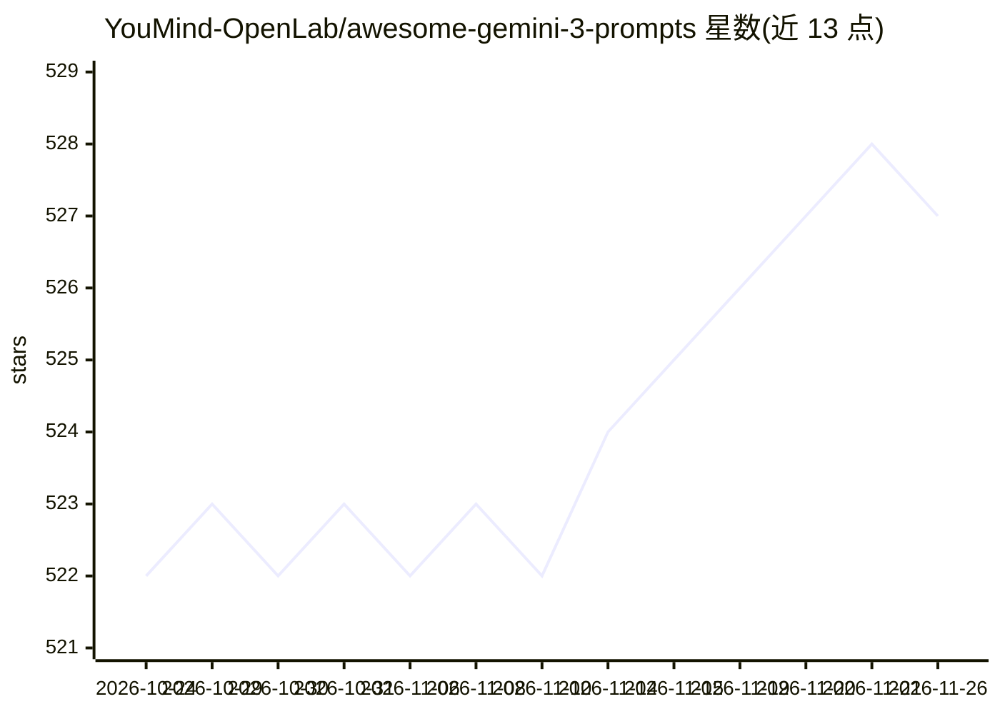

# YouMind-OpenLab/awesome-gemini-3-prompts

⭐ 527 · TypeScript · NOASSERTION · 推送 2026-11-25 · [GitHub](https://github.com/YouMind-OpenLab/awesome-gemini-3-prompts) · [官网](https://youmind.com/gemini-3-prompts) · 组织维护 · 中文 README

**面向 Gemini 3 用户的社区创意提示词精选清单**

以 Markdown 清单形式收录面向 Google Gemini 3 的社区提示词（统计为 49 条），每条包含描述、提示词正文、示例图片与作者/来源信息，来源多为 Twitter 帖子。部分提示词使用 Raycast Snippets 动态参数语法，标注 🚀 Raycast Friendly。提供 12 种语言的 README 版本与 youmind.com 网页画廊（含全文搜索与筛选）。所有内容按 CC BY 4.0 许可，来自社区收集，声明仅用于教育目的。

## 筛选速览

| 维度 | 判定 | 备注 |
|---|---|---|
| AI 角色 | `ai-knowledge` | 知识聚合/清单类 |
| 许可风险 | `none` | NOASSERTION |
| 部署形态 | `None` |  |
| 模型依赖 | — | README 未给出锁定关系 |
| 硬件要求 | — | 无带数字的原话,不猜 |
| 安装摩擦 | `low` | 无编译、无系统依赖或容器化 |
| 成熟度 | — | 结构信号不足 |

## 能力要点

- 收录 49 条面向 Gemini 3 的社区提示词，附示例图片与出处
- 部分提示词支持 Raycast Snippets 动态参数语法
- 提供 12 种语言版本的 README 与网页画廊
- 网页画廊支持全文搜索、筛选与 AI 一键生成

## 适用场景

- 想直接复用他人验证过的 Gemini 3 提示词
- 需要带动态参数的 Raycast Snippet 提示词模板
- 通过示例图片对比不同提示词写法的效果

## 场景标签

`精选清单` `提示工程` · 领域:Agent 开发

## 证据(README 行号)

> L9: > 🎨 A curated collection of creative prompts for Google's Gemini 3
> L65: |📝 Total Prompts|**49**|

## 星数曲线

2026-10-24 522 → 2026-11-26 527（+5）

---
*卡片 v1 · prompt 1.4 · 生成 2026-11-26 · 置信度 high · 依据 README sha `c455f3559d12` · [字段定义](../../DATASET.md)*
