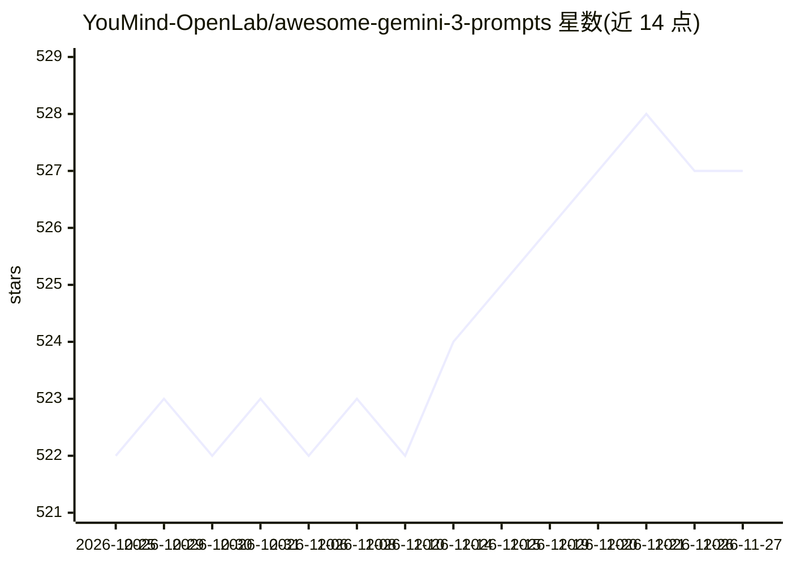

# YouMind-OpenLab/awesome-gemini-3-prompts

⭐ 527 · TypeScript · NOASSERTION · 推送 2026-11-26 · [GitHub](https://github.com/YouMind-OpenLab/awesome-gemini-3-prompts) · [官网](https://youmind.com/gemini-3-prompts) · 组织维护

**面向 Gemini 3 用户的社区创意提示词精选清单（49 条）**

收录社区来源 Gemini 3 创意提示词的清单仓库，按发布日期排列，共 49 条，每条含描述、提示词正文、示例图片与作者/来源信息。提供 12 种语言的 README 版本，并可在 youmind.com 网页画廊以瀑布流、全文搜索与 AI 一键生成方式浏览。部分提示词支持 Raycast Snippets 动态参数语法。提示词来自社区收集，仅供教育目的，仓库以 CC BY 4.0 许可发布。

## 筛选速览

| 维度 | 判定 | 备注 |
|---|---|---|
| AI 角色 | `ai-knowledge` | 知识聚合/清单类 |
| 许可风险 | `none` | NOASSERTION |
| 部署形态 | `None` |  |
| 模型依赖 | — | README 未给出锁定关系 |
| 硬件要求 | — | 无带数字的原话,不猜 |
| 安装摩擦 | `low` | 无编译、无系统依赖或容器化 |
| 成熟度 | — | 结构信号不足 |

## 能力要点

- 收录 49 条社区来源的 Gemini 3 提示词，含示例图与作者出处
- 支持 Raycast Snippets 动态参数语法的提示词条目
- 提供 youmind.com 网页画廊：瀑布流布局、全文搜索、AI 一键生成
- README 提供 12 种语言版本

## 适用场景

- 查找网页/落地页/图标生成类 Gemini 3 提示词参考
- 在 Raycast 中通过动态参数快速复用提示词
- 在网页画廊中按效果图浏览筛选提示词

## 场景标签

`提示工程` `精选清单` · 领域:Agent 开发

## 证据(README 行号)

> L9: > 🎨 A curated collection of creative prompts for Google's Gemini 3
> L65: |📝 Total Prompts|**49**|
> L69: ## 📋 All Prompts

## 星数曲线

2026-10-25 522 → 2026-11-27 527（+5）

---
*卡片 v1 · prompt 1.4 · 生成 2026-11-27 · 置信度 high · 依据 README sha `04843bc72acf` · [字段定义](../../DATASET.md)*
