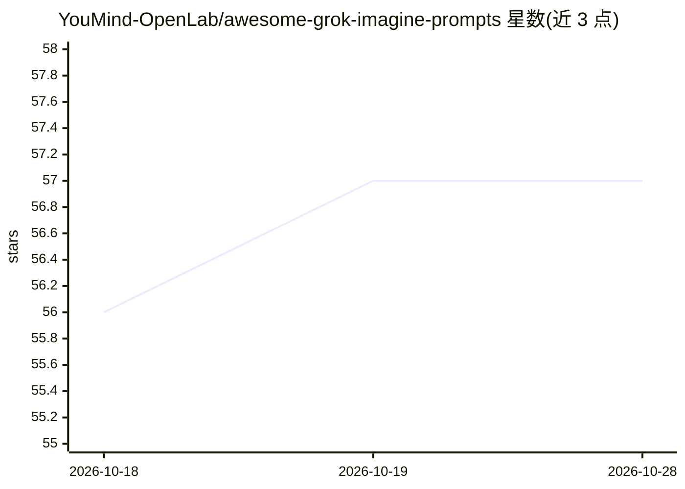

# YouMind-OpenLab/awesome-grok-imagine-prompts

⭐ 57 · TypeScript · NOASSERTION · 推送 2026-10-27 · [GitHub](https://github.com/YouMind-OpenLab/awesome-grok-imagine-prompts) · [官网](https://youmind.com/grok-imagine-prompts) · 组织维护 · 中文 README

**Grok Imagine 视频生成提示词策展清单（3198 条）**

面向 xAI Grok Imagine 文生视频用户的提示词聚合仓库：从社区（多为 Twitter 帖子）收集 3198 条提示词，每条含描述、提示词原文、作者、来源与发布日期，按发布时间排序并设 3 条精选。另在 YouMind 提供网页版画廊，支持视频播放、多字段模糊搜索与 AI 提示词推荐。README 附有 Grok Imagine 功能说明（文生视频、图生视频、视频编辑、自动配音等）。内容以 CC BY 4.0 许可，附版权申诉移除机制。

## 筛选速览

| 维度 | 判定 | 备注 |
|---|---|---|
| AI 角色 | `ai-knowledge` | 知识聚合/清单类 |
| 许可风险 | `none` | NOASSERTION |
| 部署形态 | `None` |  |
| 模型依赖 | — | README 未给出锁定关系 |
| 硬件要求 | — | 无带数字的原话,不猜 |
| 安装摩擦 | `low` | 无编译、无系统依赖或容器化 |
| 成熟度 | — | 结构信号不足 |

## 能力要点

- 收录 3198 条社区收集的 Grok Imagine 视频生成提示词
- 条目含描述、提示词原文、作者、来源与发布日期
- 配套 YouMind 网页画廊：视频播放、模糊搜索、AI 推荐
- README 说明 Grok Imagine 的文生视频/图生视频/视频编辑能力

## 适用场景

- 为 Grok Imagine 找现成的视频生成提示词
- 学习电影感、动作、动漫、产品展示等风格的提示词写法
- 浏览社区产出的视频生成效果并复用其提示词

## 场景标签

`精选清单` · 领域:学习与行业

## 证据(README 行号)

> L10: A curated collection of high-quality video generation prompts for xAI's Grok Imagine
> L49: |📝 Total Prompts|**3198**|

## 星数曲线

2026-10-18 56 → 2026-10-28 57（+1）

---
*卡片 v1 · prompt 1.4 · 生成 2026-10-24 · 置信度 high · 依据 README sha `e3cc4bafbcfe` · [字段定义](../../DATASET.md)*
