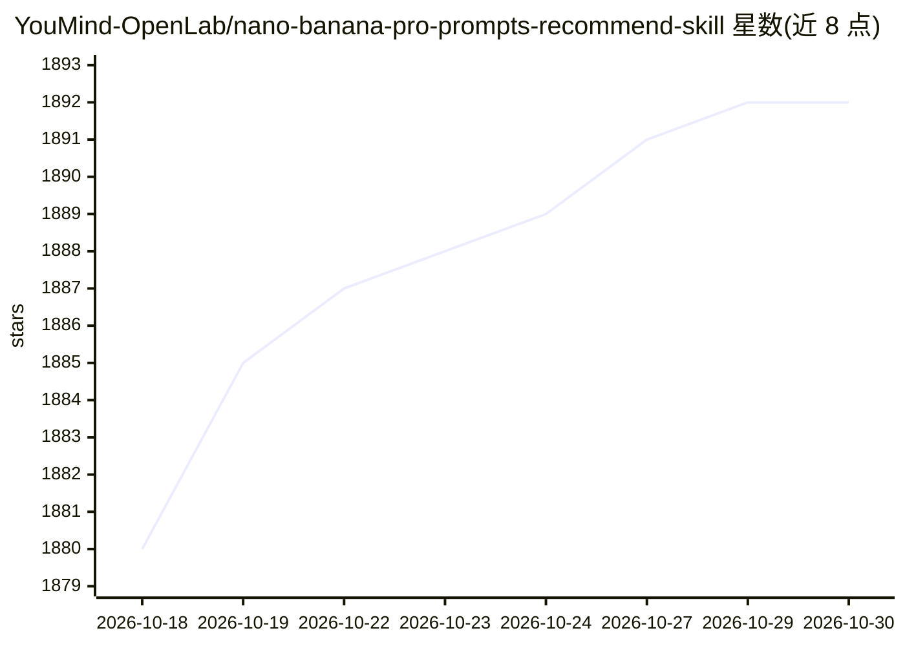

# YouMind-OpenLab/nano-banana-pro-prompts-recommend-skill

⭐ 1,892 · TypeScript · 推送 2026-10-29 · [GitHub](https://github.com/YouMind-OpenLab/nano-banana-pro-prompts-recommend-skill) · [官网](https://youmind.com/nano-banana-pro-prompts) · 组织维护

**为 AI 助手提供 1 万+ Nano Banana Pro 图像提示词检索技能**

一个面向 OpenClaw、Claude Code、Cursor 等 AI 助手的 agent skill（SKILL.md 形式）：内置 10,000+ 按 11 个类别组织的 Nano Banana Pro（Gemini 图像模型）提示词库，支持语义搜索返回前 3 匹配及示例图，并提供内容改写模式——粘贴文章或视频脚本后生成定制提示词。库由 YouMind 社区经 GitHub Actions 每日两次自动同步，采用 grep 式检索避免全量加载以控制 token 消耗。无需 YouMind 账户即可使用。

## 筛选速览

| 维度 | 判定 | 备注 |
|---|---|---|
| AI 角色 | `ai-knowledge` | 知识聚合/清单类 |
| 许可风险 | `none` | — |
| 部署形态 | `library` | 以包/库形式分发 |
| 模型依赖 | — | README 未给出锁定关系 |
| 硬件要求 | — | 无带数字的原话,不猜 |
| 安装摩擦 | `low` | 无编译、无系统依赖或容器化 |
| 成熟度 | — | 结构信号不足 |

## 能力要点

- 10,000+ 提示词按 11 个类别组织，每条含示例图
- 语义搜索返回前 3 匹配（标题翻译+英文提示词+是否需参考图）
- Content remix 模式：基于用户文章/脚本生成定制提示词
- grep 式检索只提取匹配项，不加载全量类别文件

## 适用场景

- 找社交媒体帖子、商品图、YouTube 封面等场景的图像提示词
- 把我的文章或视频脚本改写成配图提示词
- 在 Claude Code / OpenClaw 等助手里直接搜索提示词库

## 场景标签

`提示工程` `图像生成` · 领域:Agent 开发

## 证据(README 行号)

> L18: An **AI agent skill** that gives Claude, OpenClaw, Cursor, and other AI assistants the ability to intelligently sea
> L24: - ✅ **10,000+ prompts, organized by use case** — not a random dump, but professionally categorized

## 星数曲线

2026-10-18 1,880 → 2026-10-30 1,892（+12）

---
*卡片 v1 · prompt 1.4 · 生成 2026-10-21 · 置信度 high · 依据 README sha `a785a2976a03` · [字段定义](../../DATASET.md)*
