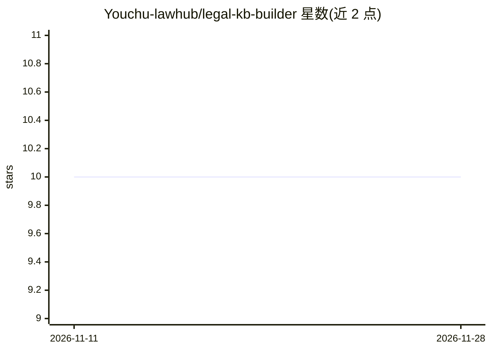

# Youchu-lawhub/legal-kb-builder

⭐ 10 · Python · NOASSERTION · 推送 2026-10-11 · [GitHub](https://github.com/Youchu-lawhub/legal-kb-builder) · 个人维护 · 中文 README

**本地法律知识库构建工具：从法律文档到咨询智能体**

以 CLI 为核心的法律材料整理、索引与检索工具，按语料形态分四条流水线（书籍 KB、裁判文书 KB、问答集 KB、Agentic 实时检索）外加跨库咨询智能体。检索采用 BM25+向量+结构索引三路 RRF 融合；解析后端在 YAML 中配置可插拔；面向法律语义区分目录条文与正文引用条文。核心工作流本地运行，向量、OCR、HTTP API 与 MCP 为按需安装项；API 全路由要求 token。许可为 CC BY-NC-ND 4.0 加附加条款，限制商业使用，作者声明其非 OSI 开源软件。

## 筛选速览

| 维度 | 判定 | 备注 |
|---|---|---|
| AI 角色 | `ai-native` | 本体是模型或模型工具 |
| 许可风险 | `none` | NOASSERTION |
| 部署形态 | `library` | 以包/库形式分发 |
| 模型依赖 | — | README 未给出锁定关系 |
| 硬件要求 | — | 无带数字的原话,不猜 |
| 安装摩擦 | `low` | 无编译、无系统依赖或容器化 |
| 成熟度 | — | 结构信号不足 |

## 能力要点

- 书籍/裁判文书/问答集/Agentic 四条流水线加跨库咨询智能体
- BM25+向量（bge-small-zh-v1.5 + FAISS）+结构索引三路 RRF 融合检索
- 解析后端可插拔：MinerU、阿里云百炼、合合信息 TextIn、PaddleOCR、LibreOffice、pandoc
- 提供 FastAPI HTTP API 与 MCP 接口，API 全路由要求 LEGAL_KB_API_TOKEN

## 适用场景

- 把法典评注、司法解释、教材等书籍建成可检索知识库
- 整理法院裁判文书形成案例检索库
- 用 FAQ/培训问答语料构建问答检索
- 部署带鉴权的法律业务咨询智能体接口

## 场景标签

`文档解析` `RAG` · 领域:知识与检索

## 证据(README 行号)

> L3: **本地法律知识库建设一体化工厂。**
> L11: - 🤖 **业务咨询智能体**：跨库编排（意图分类→KB路由→多源检索→证据模板输出），支持多轮上下文；不等同于自主法律推理。

## 星数曲线

2026-11-11 10 → 2026-11-28 10（+0）

---
*卡片 v1 · prompt 1.4 · 生成 2026-11-20 · 置信度 high · 依据 README sha `bca5586d36e1` · [字段定义](../../DATASET.md)*
