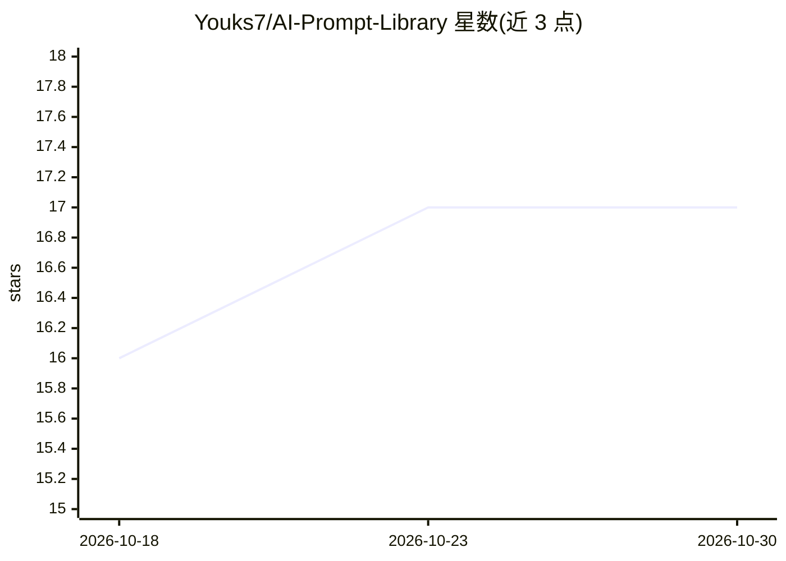

# Youks7/AI-Prompt-Library

⭐ 17 · JavaScript · NOASSERTION · 推送 2026-08-30 · [GitHub](https://github.com/Youks7/AI-Prompt-Library) · 个人维护 · 中文 README

**电商内容与视觉生产用的结构化 Prompt 与工作流库**

面向电商内容创作者的结构化 Prompt 库：收录 88 条结构化 Prompt、11 个复杂工作流、9 个主题分类和 36 个关联视觉示例，覆盖详情页文案、TikTok 短视频、AI 生图、视频分镜、中泰本地化翻译和自动化报告等场景。内容按任务、输入、模型、案例与执行阶段整理，网站、索引和 Agent Skill 从同一结构化目录生成。仓库含 kero-prompt-router，可按任务类型选择 Prompt 或工作流并识别缺失资料。本地构建需 Node.js 20+，采用双许可。

## 筛选速览

| 维度 | 判定 | 备注 |
|---|---|---|
| AI 角色 | `ai-knowledge` | 知识聚合/清单类 |
| 许可风险 | `none` | NOASSERTION |
| 部署形态 | `None` |  |
| 模型依赖 | — | README 未给出锁定关系 |
| 硬件要求 | — | 无带数字的原话,不猜 |
| 安装摩擦 | `low` | 无编译、无系统依赖或容器化 |
| 成熟度 | — | 结构信号不足 |

## 能力要点

- 88 条结构化 Prompt + 11 个多阶段 Workflow Pack
- kero-prompt-router 按任务选择 Prompt 并识别缺失资料
- 网站、索引与 Agent Skill 从同一结构化目录生成
- npm run build 可重新生成目录与索引数据

## 适用场景

- 做电商详情页、主图和广告文案时直接取用结构化 Prompt
- 为 TikTok 短视频和 AI 生图任务选用多阶段工作流
- 让 Agent 通过 kero-prompt-router 自动匹配合适 Prompt

## 场景标签

`提示工程` · 领域:Agent 开发

## 证据(README 行号)

> L3:  面向电商内容与视觉生产的结构化 Prompt、真实案例和 Agent 工作流库
> L26: 本项目把真实内容生产中使用的 Prompt 按任务、输入、模型、案例和执行阶段整理。你可以直接复制一条 Prompt，也可以使用多阶段 Workflow Pack 完成分析、方向选择、生成、迭代和验收。

## 星数曲线

2026-10-18 16 → 2026-10-30 17（+1）

---
*卡片 v1 · prompt 1.4 · 生成 2026-10-29 · 置信度 high · 依据 README sha `dc868949e516` · [字段定义](../../DATASET.md)*
