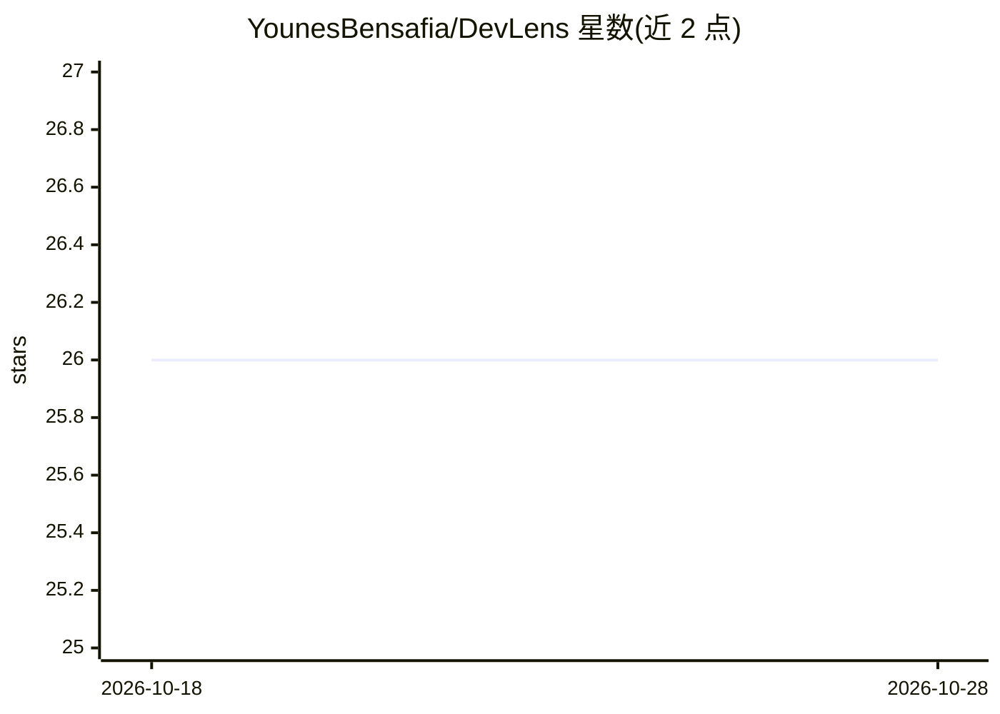

# YounesBensafia/DevLens

⭐ 26 · Python · MIT · 推送 2026-06-05 · [GitHub](https://github.com/YounesBensafia/DevLens) · [官网](https://pypi.org/project/devlens-tool/) · 个人维护

**Python 代码库可读性扫描器：为每个文件打 0-100 分**

面向开发者的 CLI 工具，扫描 Python 项目并对每个文件按可理解难度打 0-100 分：结合代码复杂度指标（50%）、git 历史信号（30%）与可选 LLM 判断（20%，权重可在 pyproject.toml 调整）。支持趋势对比与回归检测，另提供项目统计与逐文件 AI 摘要。附带 check-pr 命令，用 6 种纯启发式信号检测 AI 生成或低质量 PR，无 LLM 调用、确定性，可嵌入 CI。AI 功能需设置 OpenAI 兼容 API 的环境变量，--no-llm 模式无网络依赖。

## 筛选速览

| 维度 | 判定 | 备注 |
|---|---|---|
| AI 角色 | `ai-enhanced` | 去掉 AI 部分产品仍成立 |
| 许可风险 | `permissive` | MIT |
| 部署形态 | `library` | 以包/库形式分发 |
| 模型依赖 | — | README 未给出锁定关系 |
| 硬件要求 | — | 无带数字的原话,不猜 |
| 安装摩擦 | `low` | 无编译、无系统依赖或容器化 |
| 成熟度 | — | 结构信号不足 |

## 能力要点

- 三层评分：复杂度指标 + git 历史 + 可选 LLM，权重可配置
- check-pr 用 6 种启发式信号检测 AI 生成 PR，零 LLM 调用、确定性
- 趋势与回归对比：显示项目分数随时间变化与恶化文件
- 兼容任意 OpenAI 兼容 API 作为 AI 提供方

## 适用场景

- 新成员入职时快速定位最难懂的文件
- 在 CI 中合并前拦截 AI 生成或低质量 PR
- 向管理层汇报代码库可理解度的季度趋势

## 场景标签

 · 领域:开发工具/代码分析

## 证据(README 行号)

> L14: Lost in a new codebase? DevLens scans your Python project and scores every file from 0 to 100 based on how hard it 
> L16: DevLens also detects AI-generated or low-effort pull requests using pure heuristic signals: no LLM calls, no API co
> L48: |`devlens -scan <PATH> --no-llm`|Scan without AI (deterministic, works in CI)|

## 星数曲线

2026-10-18 26 → 2026-10-28 26（+0）

---
*卡片 v1 · prompt 1.4 · 生成 2026-10-26 · 置信度 high · 依据 README sha `f7503e924c69` · [字段定义](../../DATASET.md)*
