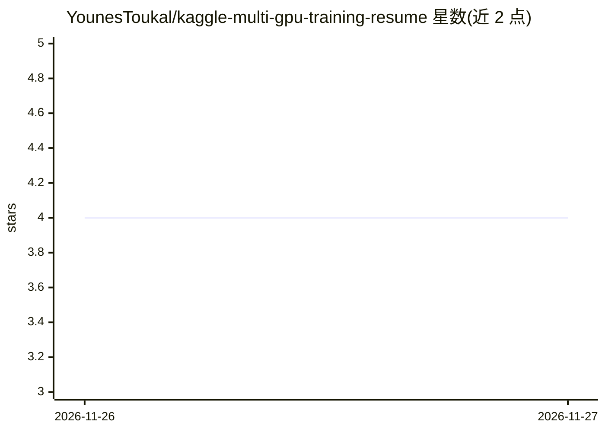

# YounesToukal/kaggle-multi-gpu-training-resume

⭐ 4 · Jupyter Notebook · MIT · 推送 2026-11-24 · [GitHub](https://github.com/YounesToukal/kaggle-multi-gpu-training-resume) · 个人维护

**在 Kaggle 双 T4 GPU 上训练并可跨 12 小时会话续训的 PyTorch 模板**

一个 Kaggle notebook 模板，解决标准 PyTorch 训练循环只使用单卡、且 Kaggle 会话 12 小时强制中断两个问题。通过 torchrun 在两块 T4 上各启动一个 DDP 进程并同步梯度，按时间块分割训练，预计块耗时时长，在 11.25 小时限时前保存完整状态（权重、优化器、LR 调度、scaler、步数、随机状态）；新会话从 /kaggle/input 读入上一版本输出并重建 mid-epoch 的批次顺序续训。README 记录测试表明续训与不间断运行产生相同权重。提供 train.py/launch.py 拆分文件与 pytest 续训测试。

## 筛选速览

| 维度 | 判定 | 备注 |
|---|---|---|
| AI 角色 | `ai-native` | 本体是模型或模型工具 |
| 许可风险 | `permissive` | MIT |
| 部署形态 | `library` | 以包/库形式分发 |
| 模型依赖 | — | README 未给出锁定关系 |
| 硬件要求 | — | 无带数字的原话,不猜 |
| 安装摩擦 | `low` | 无编译、无系统依赖或容器化 |
| 成熟度 | — | 结构信号不足 |

## 能力要点

- torchrun + DDP 在 Kaggle 双 T4 上并行训练，文中测试为单卡 1.9× 速度
- checkpoint 保存优化器、LR 调度、scaler、步数与 GPU 随机状态，先写临时文件再原子重命名
- mid-epoch 续训：重建同批次顺序并跳过已训练批次
- 三 GPU 同步规则与 rank0-only 写文件的容错约定

## 适用场景

- 在 Kaggle 免费配额内跑超过 12 小时的训练任务
- 将单卡 PyTorch 训练脚本改为双 GPU DDP 版本
- 验证训练在多会话中断恢复后结果可复现

## 场景标签

`模型训练` · 领域:训练与推理

## 证据(README 行号)

> L7: Kaggle gives you two T4 GPUs, but a standard PyTorch training loop uses only one of them, and every session ends aft
> L11: - **Both GPUs train at once.** In the article's test, this was 1.9× faster than a single T4.

## 星数曲线

2026-11-26 4 → 2026-11-27 4（+0）

---
*卡片 v1 · prompt 1.4 · 生成 2026-11-26 · 置信度 high · 依据 README sha `f8b9dc16cf27` · [字段定义](../../DATASET.md)*
