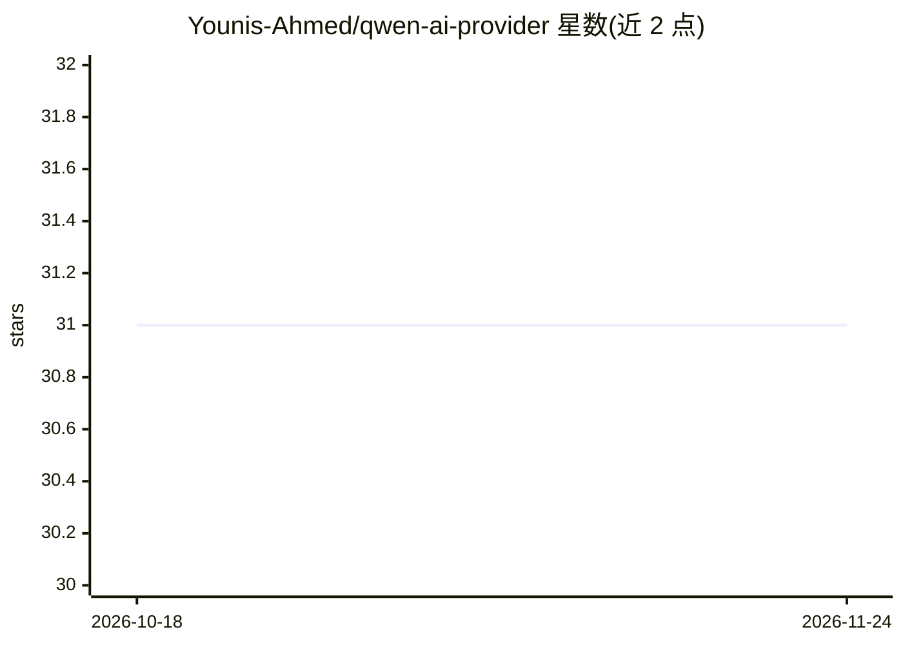

# Younis-Ahmed/qwen-ai-provider

⭐ 31 · TypeScript · 推送 2026-11-03 · [GitHub](https://github.com/Younis-Ahmed/qwen-ai-provider) · [官网](https://www.npmjs.com/package/qwen-ai-provider) · 个人维护 · 中文 README

**社区构建的 Qwen 模型接入 Vercel AI SDK 的 Provider 包**

面向 Vercel AI SDK 开发者的社区 Provider 模块，将阿里云 DashScope 上的 Qwen 系列模型（qwen-plus、qwen-max、qwen-vl-max、qwen2.5 系列及 text-embedding-v3 嵌入模型）接入 SDK 的 generateText/streamText/generateObject/embed 等函数。支持图像输入、对象生成、工具调用与工具流式的能力矩阵，可配置 baseURL、apiKey、自定义 headers 与 fetch。需设置 DASHSCOPE_API_KEY，默认 API 前缀为 dashscope-intl 的 compatible-mode/v1。以 npm 包分发，附多个 TypeScript 示例。

## 筛选速览

| 维度 | 判定 | 备注 |
|---|---|---|
| AI 角色 | `ai-ecosystem` | LLM/agent 周边工具 |
| 许可风险 | `none` | — |
| 部署形态 | `library` | 以包/库形式分发 |
| 模型依赖 | — | README 未给出锁定关系 |
| 硬件要求 | — | 无带数字的原话,不猜 |
| 安装摩擦 | `low` | 无编译、无系统依赖或容器化 |
| 成熟度 | — | 结构信号不足 |

## 能力要点

- 在 Vercel AI SDK 中调用 Qwen 聊天模型，支持工具调用与对象生成
- textEmbeddingModel 接入 text-embedding-v3 嵌入模型
- 可配置 baseURL/apiKey/headers/自定义 fetch
- 提供图像输入模型（qwen-vl-max、qwen2.5-vl 系列）

## 适用场景

- 在 Vercel AI SDK / Next.js 应用中使用 Qwen 模型生成文本
- 用 Qwen 嵌入模型做向量化
- 通过自定义 baseURL 代理访问 DashScope API

## 场景标签

 · 领域:LLM 基础设施/模型接入

## 证据(README 行号)

> L24: The Qwen provider is available in the `qwen-ai-provider` module. You can install it with:
> L46: import { qwen } from 'qwen-ai-provider';
> L91: import { qwen } from 'qwen-ai-provider';

## 星数曲线

2026-10-18 31 → 2026-11-24 31（+0）

---
*卡片 v1 · prompt 1.4 · 生成 2026-11-18 · 置信度 high · 依据 README sha `b716c61cc1fa` · [字段定义](../../DATASET.md)*
