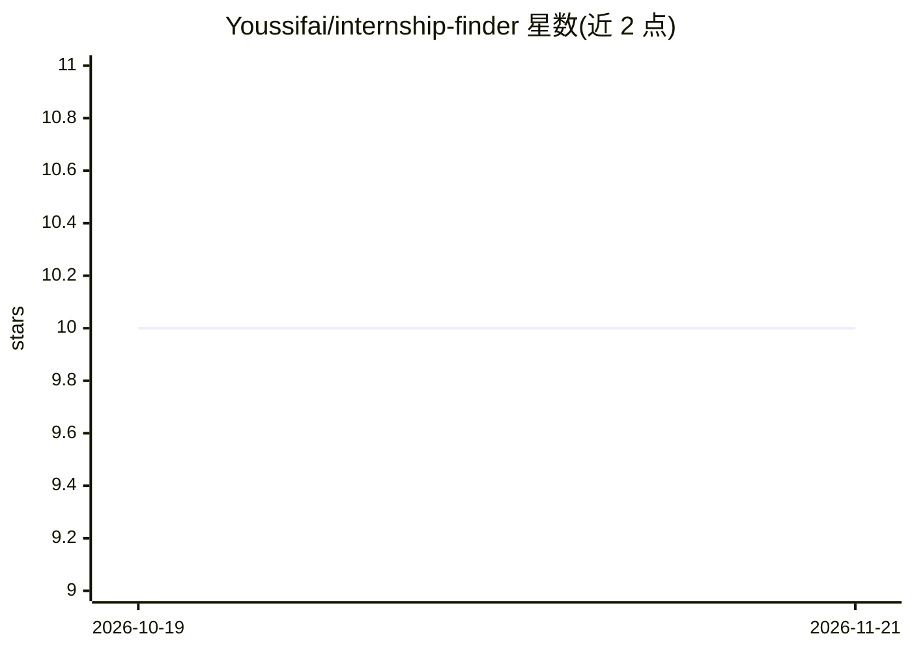

# Youssifai/internship-finder

⭐ 10 · JavaScript · MIT · 推送 2026-06-26 · [GitHub](https://github.com/Youssifai/internship-finder) · 个人维护

**基于 Claude Code 的求职工作台：评分职位并生成定制申请材料**

以 Claude Code skill 形式在本机运行的项目：对职位做 5 维评分（低于阈值自动跳过），按角色重写生成 LaTeX CV、HTML 求职信等申请包；用 Playwright 抓取职位页并以 "BESTÄTIGT" 确认门控填表；Notion 数据库跟踪申请状态、记录拒信、提供带 Deepgram 实时翻译的面试演练。默认面向德国汽车/工程市场，/setup 引导重定向到任意市场，数据留在本地。

## 筛选速览

| 维度 | 判定 | 备注 |
|---|---|---|
| AI 角色 | `ai-native` | 本体是模型或模型工具 |
| 许可风险 | `permissive` | MIT |
| 部署形态 | `library` | 以包/库形式分发 |
| 模型依赖 | locked-api |  |
| 硬件要求 | — | 无带数字的原话,不猜 |
| 安装摩擦 | `low` | 无编译、无系统依赖或容器化 |
| 成熟度 | — | 结构信号不足 |

## 能力要点

- 5 维评分先行、低于 3.0/5 自动跳过的两段式流水线
- Playwright 填表前强制 "BESTÄTIGT" 人工确认门控
- /setup 引导生成 cv.md、profile.yml 等个性化配置
- 英/德/法三语言包与 Notion 申请跟踪

## 适用场景

- 为每个职位生成定制化 CV 与求职信 PDF
- 抓取 Greenhouse/Lever 等职位页并管理申请流水线
- 非母语面试场景下的德英实时翻译演练
- 用 Notion 跟踪申请状态并自动标记相似被拒职位

## 场景标签

`浏览器自动化` `AI 助手` · 领域:效率与自动化

## 证据(README 行号)

> L3: > An AI job-search command center built on Claude Code. Score offers, generate tailored CVs and cover letters, fill 
> L16: It runs as a Claude Code skill on your machine. Your CV, contact info, and notes stay local — only the JD and your 
> L20: - **Scores offers** with a structured 5-dimension fit check (technical overlap, domain alignment, interview defensi

## 星数曲线

2026-10-19 10 → 2026-11-21 10（+0）

---
*卡片 v1 · prompt 1.4 · 生成 2026-11-20 · 置信度 mid · 依据 README sha `3e78dbf1aace` · [字段定义](../../DATASET.md)*
