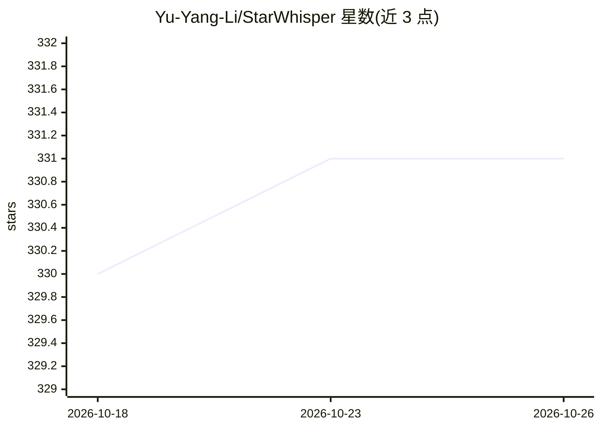

# Yu-Yang-Li/StarWhisper

⭐ 331 · Python · Apache-2.0 · 推送 2026-10-19 · [GitHub](https://github.com/Yu-Yang-Li/StarWhisper) · [官网](https://yu-yang-li.github.io/StarWhisper/) · 个人维护 · 中文 README

**天文语言模型与自主观测研究的代码数据集合**

收录天文语言模型（StarWhisper 3 权重与训练数据）、光变曲线与暂现源分类、恒星光谱分析、望远镜自主观测调度等工作的代码、数据和模型，相关工作由国家天文台、之江实验室等单位支持。另提供可安装到 Codex / Cursor 的科研技能（文献检索、研究设计、统计、写作与绘图）。部分项目配有本地读取命令，重新训练需自备数据与环境，完整观测流程需台站系统。

## 筛选速览

| 维度 | 判定 | 备注 |
|---|---|---|
| AI 角色 | `ai-native` | 本体是模型或模型工具 |
| 许可风险 | `permissive` | Apache-2.0 |
| 部署形态 | `None` |  |
| 模型依赖 | — | README 未给出锁定关系 |
| 硬件要求 | — | 无带数字的原话,不猜 |
| 安装摩擦 | `low` | 无编译、无系统依赖或容器化 |
| 成熟度 | — | 结构信号不足 |

## 能力要点

- 覆盖天文语言模型、光变/光谱分析、观测调度多方向
- 科研技能可按任务安装到 Codex / Cursor
- SN Clock 等项目提供本地读取命令，无需额外依赖
- 多篇论文发表于 Communications Engineering、NeurIPS workshop 等

## 适用场景

- 获取天文 LLM 训练数据与模型权重
- 复现光变曲线分类、光谱分析等天文研究
- 为 Codex / Cursor 安装科研技能辅助天文研究
- 查阅望远镜自主观测端到端框架代码

## 场景标签

`科研工具` · 领域:学习与行业

## 证据(README 行号)

> L7: StarWhisper（星语）收录了天文语言模型、光变曲线与光谱分析、望远镜自主观测等工作的代码、数据和模型。这里也有一些可在 Codex / Cursor 中使用的科研技能。相关工作由国家天文台、之江实验室等单位支持。
> L16: |天文语言模型|训练数据 · StarWhisper 3 权重|
> L27: 先在项目目录查看各项工作已经提供的材料和运行条件。SN Clock、Explore、稀疏光变指标和 NGSS 配置有现成的本地读取命令；重新训练模型需要对应的数据与环境，完整观测流程还需准备台站系统。科研技能也可按任务安装到 Co

## 星数曲线

2026-10-18 330 → 2026-10-26 331（+1）

---
*卡片 v1 · prompt 1.4 · 生成 2026-10-22 · 置信度 high · 依据 README sha `b314ab67b1b7` · [字段定义](../../DATASET.md)*
