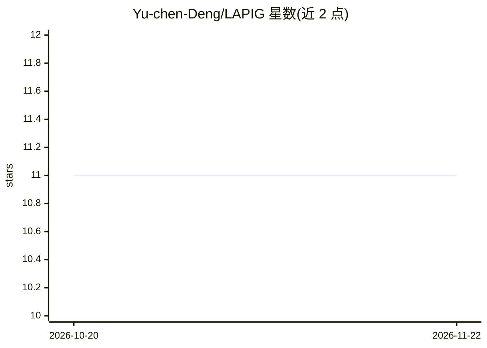

# Yu-chen-Deng/LAPIG

⭐ 11 · Python · NOASSERTION · 推送 2026-04-16 · [GitHub](https://github.com/Yu-chen-Deng/LAPIG) · [官网](https://yuchendeng.com/LAPIG/) · 组织维护

**研究者：语言引导的投影仪图像生成与表面适应实现**

LAPIG 的 PyTorch 官方实现，论文发表于 IEEE TVCG 并入选 VR'25。工具基于投影仪-相机（ProCams）系统，根据语言描述与表面适应性生成投影图像并进行风格化。提供 conda 环境配置、采样图像数据集下载、visdom 训练可视化及 GPU 选择等完整工作流程；无真实投影仪硬件时可用 Blender 合成模式替代。部分依赖真实硬件的实验结果无法复现，论文 Table 1 提供约 1.01 GB 的 checkpoint 与数据用于复现。仅授权非商业、非营利使用。

## 筛选速览

| 维度 | 判定 | 备注 |
|---|---|---|
| AI 角色 | `ai-native` | 本体是模型或模型工具 |
| 许可风险 | `none` | NOASSERTION |
| 部署形态 | `None` |  |
| 模型依赖 | — | README 未给出锁定关系 |
| 硬件要求 | — | 无带数字的原话,不猜 |
| 安装摩擦 | `low` | 无编译、无系统依赖或容器化 |
| 成熟度 | — | 结构信号不足 |

## 能力要点

- PyTorch 实现的语言引导投影仪图像生成（表面适应与风格化）
- 提供采样图像数据集与复现脚本（reproduce_table_1.py）
- 无投影仪硬件时支持 Blender 合成模式（capture_mode: synthetic）
- visdom 可视化训练过程，支持本地或远程训练

## 适用场景

- 在投影仪-相机系统上生成适应物体表面的投影图像
- 没有真实投影设备时用 Blender 环境做合成实验
- 复现论文 Table 1 的实验结果

## 场景标签

`图像生成` `图像视频处理` · 领域:内容生成

## 证据(README 行号)

> L10: PyTorch's implementation of LAPIG.
> L13: * PyTorch compatible GPU
> L52:  > Note: If ProCams hardware is not available, we also provide an implementation in Blender environment. Simply set

## 星数曲线

2026-10-20 11 → 2026-11-22 11（+0）

---
*卡片 v1 · prompt 1.4 · 生成 2026-11-18 · 置信度 high · 依据 README sha `e578820c19bb` · [字段定义](../../DATASET.md)*
