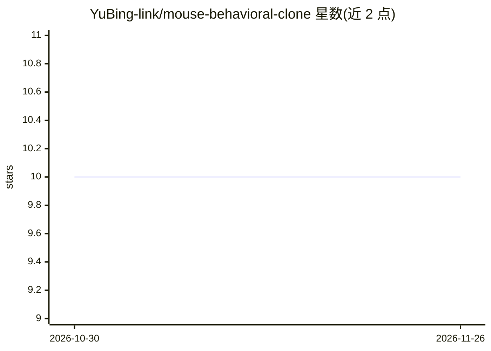

# YuBing-link/mouse-behavioral-clone

⭐ 10 · Python · MIT · 推送 2026-05-17 · [GitHub](https://github.com/YuBing-link/mouse-behavioral-clone) · 个人维护

**用你的鼠标数据训练 GRU 模型，生成拟人光标轨迹用于浏览器自动化**

三阶段流水线：Bezier 生成骨架、NoiseModel 学习个人空间偏差（~166KB）、GRU（MouseModelV3）学习个人时间特征（~2MB），输出重采样为 ~125Hz 鼠标事件。数据采集通过 Tampermonkey 用户脚本记录真实操作为 .jsonl；训练脚本自动发现数据文件，支持增量训练、检查点恢复与可视化示例；CPU 推理 <5ms，无模型时回退纯 Bezier 曲线。README 说明约 100 条轨迹可验证流程，键盘与滚动行为尚未建模。

## 筛选速览

| 维度 | 判定 | 备注 |
|---|---|---|
| AI 角色 | `ai-native` | 本体是模型或模型工具 |
| 许可风险 | `permissive` | MIT |
| 部署形态 | `library` | 以包/库形式分发 |
| 模型依赖 | — | README 未给出锁定关系 |
| 硬件要求 | — | 无带数字的原话,不猜 |
| 安装摩擦 | `low` | 无编译、无系统依赖或容器化 |
| 成熟度 | — | 结构信号不足 |

## 能力要点

- 三阶段流水线：Bezier 骨架 + NoiseModel 空间个性化 + GRU 时间个性化
- ~2MB GRU 模型，CPU 推理 <5ms
- Tampermonkey 脚本采集个人鼠标数据，支持增量训练与恢复
- 125Hz 自适应重采样，含时间/空间抖动与可变事件数

## 适用场景

- 浏览器自动化中生成符合个人风格的鼠标移动路径
- 在自有数据上训练个性化轨迹模型并迭代改进
- 可视化对比流水线输出与纯 Bezier 曲线的差异

## 场景标签

`浏览器自动化` · 领域:效率与自动化

## 证据(README 行号)

> L3: Train a personalized mouse trajectory model on **your own** mouse movements, then use it to generate human-like curs
> L10: Bezier (skeleton)  →  NoiseModel (spatial)  →  GRU (temporal)  →  125Hz resample
> L17: |**GRU (MouseModelV3)**|Learns your personal timing — receives spatial path, predicts arrival times|per-point times

## 星数曲线

2026-10-30 10 → 2026-11-26 10（+0）

---
*卡片 v1 · prompt 1.4 · 生成 2026-11-20 · 置信度 high · 依据 README sha `d4e8561d6937` · [字段定义](../../DATASET.md)*
