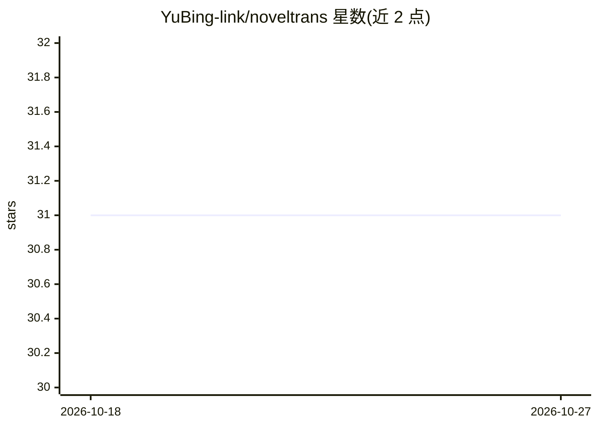

# YuBing-link/noveltrans

⭐ 31 · Java · MIT · 推送 2026-06-03 · [GitHub](https://github.com/YuBing-link/noveltrans) · 个人维护 · 中文 README

**面向网文作者与译者的 AI 翻译 SaaS 平台**

面向网络小说作者与译者的全栈翻译平台后端：多引擎编排（Python FastAPI LLM 引擎 + 本地 MTranServer，基于滚动性能窗口的概率路由与双向故障切换）、Redis HNSW 向量 RAG 翻译记忆（余弦相似度≥0.85 跳过 LLM 调用）、实体一致性管线（专有名词哈希占位符替换）、AgentScope 三智能体协作（译者+术语学家+润色师）、Stripe 订阅计费与团队多租户协作。客户端含 React 仪表盘、Chrome 扩展与 API Key 认证的 REST API。通过 Docker Compose（6 容器）部署，需配置 MySQL、Stripe 与 LLM 凭证，初始启动约 5-10 分钟。

## 筛选速览

| 维度 | 判定 | 备注 |
|---|---|---|
| AI 角色 | `ai-native` | 本体是模型或模型工具 |
| 许可风险 | `permissive` | MIT |
| 部署形态 | `self-host` | docker 或自建部署 |
| 模型依赖 | local-ok | 支持本地模型 |
| 硬件要求 | — | 无带数字的原话,不猜 |
| 安装摩擦 | `low` | 无编译、无系统依赖或容器化 |
| 成熟度 | — | 结构信号不足 |

## 能力要点

- 4 级翻译管线（缓存→RAG 语义检索→实体占位符替换→引擎调用），各级可短路
- RAG 翻译记忆基于 Redis HNSW 向量检索，相似度≥0.85 跳过 LLM 调用降低成本
- AgentScope 三智能体协作翻译，按题材匹配提示词
- Stripe 订阅三级套餐（FREE/PRO/MAX）与三级支付幂等设计

## 适用场景

- 网络小说作者批量翻译章节并保持角色名前后一致
- 翻译团队用多租户工作区分配章节任务并审校
- 第三方应用通过 API Key 接入翻译 REST API
- 通过 Chrome 扩展在网页上做整页/阅读模式/划词翻译

## 场景标签

`多智能体` `RAG` · 领域:Agent 开发

## 证据(README 行号)

> L15: NovelTrans is a full-stack translation platform built for web novel authors and translators. It replaces the tradit
> L25: - **RAG translation memory** — Redis HNSW vector search with embedding-based semantic matching (OpenAI `text-embedd

## 星数曲线

2026-10-18 31 → 2026-10-27 31（+0）

---
*卡片 v1 · prompt 1.4 · 生成 2026-10-26 · 置信度 high · 依据 README sha `8185a19a6045` · [字段定义](../../DATASET.md)*
