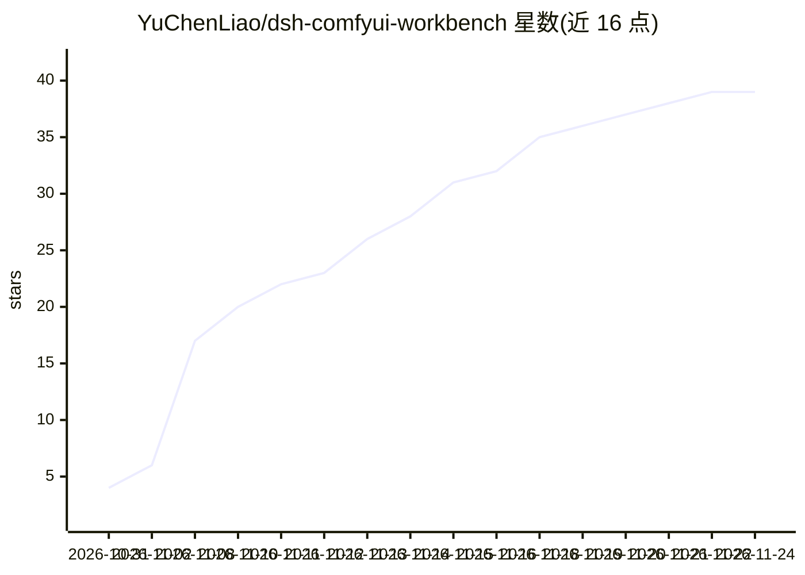

# YuChenLiao/dsh-comfyui-workbench

⭐ 48 · JavaScript · MIT · 推送 2026-11-22 · [GitHub](https://github.com/YuChenLiao/dsh-comfyui-workbench) · 个人维护 · 中文 README

**DSH 插件：让模型调用本机 ComfyUI 工作流并管理生图资产**

DSH 宿主的 ComfyUI 工作台插件，把本机 ComfyUI 工作流交给模型调用。由十一个独立 entry 组成：资产库、工作流管理、标签库、姿势库（288 组/1439 角度）、衣装库（1407+1320 套）、ComfyUI 终端等面板，以及 comfyui_run/comfyui_compose/danbooru_lookup 等工具。支持自动拉起本机 ComfyUI、异步/同步出图、批量运行与产物重跑。内置 99372 条 Danbooru 中英标签库（2-gram 倒排索引，随包分发）。不内置生图前端，是 dsh-comfyui-album 的继任者。

## 筛选速览

| 维度 | 判定 | 备注 |
|---|---|---|
| AI 角色 | `ai-ecosystem` | LLM/agent 周边工具 |
| 许可风险 | `permissive` | MIT |
| 部署形态 | `library` | 以包/库形式分发 |
| 模型依赖 | — | README 未给出锁定关系 |
| 硬件要求 | — | 无带数字的原话,不猜 |
| 安装摩擦 | `low` | 无编译、无系统依赖或容器化 |
| 成熟度 | — | 结构信号不足 |

## 能力要点

- 七个模型工具：运行/重跑/批量/节点搜索/素材编排/工作流查看与编辑
- 探测到本机 ComfyUI 时自动拉起服务，空闲可配置回收
- 内置 Danbooru 四类标签库 99372 条（含中文名），本地查询约 1ms，主站超时自动切 safebooru 镜像
- 启发式词表的 NSFW 资产隐藏（渲染层过滤，负向提示词不参与判定）

## 适用场景

- 让 AI 助手按需调用我的 ComfyUI 工作流出图，不用手抄参数
- 管理生图产物资产库并按工作流批量导出 ZIP
- 把中文名/角色名翻译成 Danbooru 标准 tag 拼进提示词
- 从姿势库取线稿、衣装库取参考图作为工作流输入

## 场景标签

`图像生成` `提示工程` · 领域:Agent 开发

## 证据(README 行号)

> L5: 给 DSH 的 ComfyUI 工作台：**把本机的 ComfyUI 工作流交给模型调用**，并管理"哪些工作流对模型可用"。
> L7: 面向用户的界面是六块：资产库、工作流管理、标签库、姿势库、衣装库、ComfyUI 终端 —— 都由 ComfyUI 原生能力支撑，不新增一套平行的状态。**不内置生图前端** —— 想手工出图直接开 ComfyUI 就行。

## 星数曲线

2026-10-31 4 → 2026-11-24 39（+35）

---
*卡片 v1 · prompt 1.4 · 生成 2026-11-18 · 置信度 mid · 依据 README sha `79a9de32ee11` · [字段定义](../../DATASET.md)*
