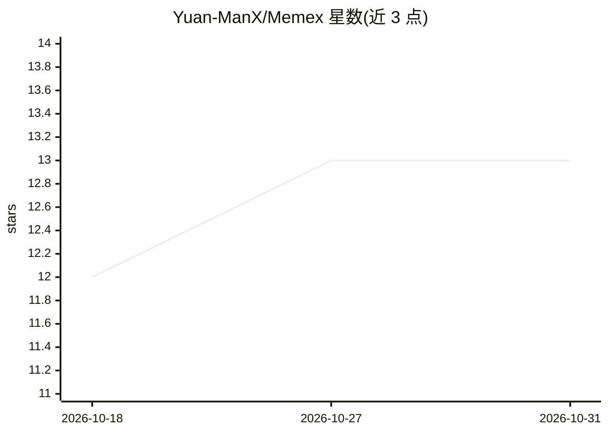

# Yuan-ManX/Memex

⭐ 13 · Python · MIT · 推送 2026-05-19 · [GitHub](https://github.com/Yuan-ManX/Memex) · 个人维护

**为 AI agent 与 LLM 应用提供持久化记忆层的基础设施**

开源记忆基础设施，面向 AI agent 与 LLM 应用：将原始交互转化为结构化记忆单元（偏好、事实、关系、事件），支持语义/关键词/混合/agentic 多查询检索，并通过对记忆的摘要、合并、重要性评分与时序推理实现自演化。宣称支持对话、文档、图像、音频、视频等多模态记忆的统一表示。提供 Python 包与 REST API 两种接入方式，可通过 pip 安装或源码构建。记忆图引擎、多 agent 共享记忆等仍列于 Roadmap 未实现。

## 筛选速览

| 维度 | 判定 | 备注 |
|---|---|---|
| AI 角色 | `ai-ecosystem` | LLM/agent 周边工具 |
| 许可风险 | `permissive` | MIT |
| 部署形态 | `library` | 以包/库形式分发 |
| 模型依赖 | — | README 未给出锁定关系 |
| 硬件要求 | — | 无带数字的原话,不猜 |
| 安装摩擦 | `low` | 无编译、无系统依赖或容器化 |
| 成熟度 | — | 结构信号不足 |

## 能力要点

- 原始交互转化为结构化记忆单元（5 类记忆类型）
- 语义/关键词/混合/agentic 多查询四种检索策略
- 记忆自演化：摘要、合并、重要性评分、时序推理
- 宣称支持对话/文档/图像/音频/视频多模态统一表示

## 适用场景

- 让 AI 助手跨会话记住用户偏好与上下文
- 为自主 agent 提供长期知识积累与经验回放
- 让 AI 工作流从历史任务中沉淀可检索记忆

## 场景标签

`Agent 记忆` · 领域:Agent 开发

## 证据(README 行号)

> L6: Memex is an open-source memory infrastructure designed for AI agents and LLM-powered applications.
> L106: Memex is designed as a **modular memory infrastructure**.
> L117: - **Memory Extraction** — convert raw data into memory units

## 星数曲线

2026-10-18 12 → 2026-10-31 13（+1）

---
*卡片 v1 · prompt 1.4 · 生成 2026-10-31 · 置信度 mid · 依据 README sha `064e8f54c139` · [字段定义](../../DATASET.md)*
