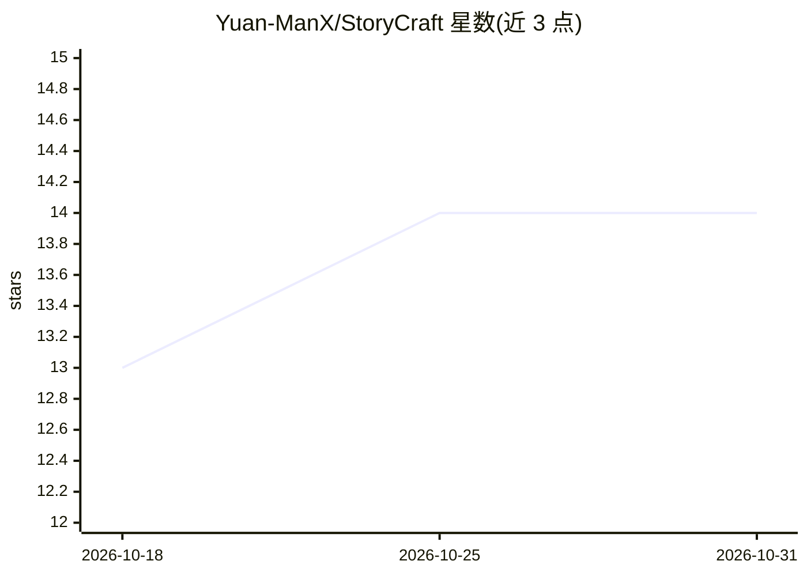

# Yuan-ManX/StoryCraft

⭐ 14 · Python · MIT · 推送 2026-03-06 · [GitHub](https://github.com/Yuan-ManX/StoryCraft) · 个人维护

**AI 视频代理系统：按主题意图生成完整剪辑的成片**

面向内容创作者的视频 Agent 系统：根据用户主题与意图生成叙事故事线和分镜脚本，自动收集、检索与组织媒体素材，进行视觉剪辑、调色、配乐、配音与音效合成，产出完整剪辑的成片。支持通过自然语言命令对脚本、画面、音频与风格做细粒度调整，可将完整生产流程保存为可复用的 Skill 以批量产片。安装方式为 git clone 源码并以 conda 创建 Python>=3.11 环境；Web UI、移动端等仍在路线图未完成阶段。

## 筛选速览

| 维度 | 判定 | 备注 |
|---|---|---|
| AI 角色 | `ai-native` | 本体是模型或模型工具 |
| 许可风险 | `permissive` | MIT |
| 部署形态 | `None` |  |
| 模型依赖 | — | README 未给出锁定关系 |
| 硬件要求 | — | 无带数字的原话,不猜 |
| 安装摩擦 | `low` | 无编译、无系统依赖或容器化 |
| 成熟度 | — | 结构信号不足 |

## 能力要点

- 基于主题生成故事线与分镜脚本
- 自动收集/检索/组织媒体素材的编排系统
- 视觉剪辑、调色、音乐、配音、音效一体化合成
- 生产流程可保存为 Skill 复用，支持批量生成

## 适用场景

- 生成社交媒体与 YouTube 视频内容
- 辅助影视前期与后期制作流程
- 用模板批量产出产品演示、营销视频
- 自动制作教程与教育内容

## 场景标签

`视频生成` · 领域:内容生成

## 证据(README 行号)

> L3: **StoryCraft** is an AI-Powered Video Agent System that understands intent, constructs storylines, orchestrates narr
> L11:  Generates narrative storylines and shot-by-shot scripts based on user themes, visual understanding, and context-aw

## 星数曲线

2026-10-18 13 → 2026-10-31 14（+1）

---
*卡片 v1 · prompt 1.4 · 生成 2026-10-31 · 置信度 mid · 依据 README sha `6442c3ab5e09` · [字段定义](../../DATASET.md)*
