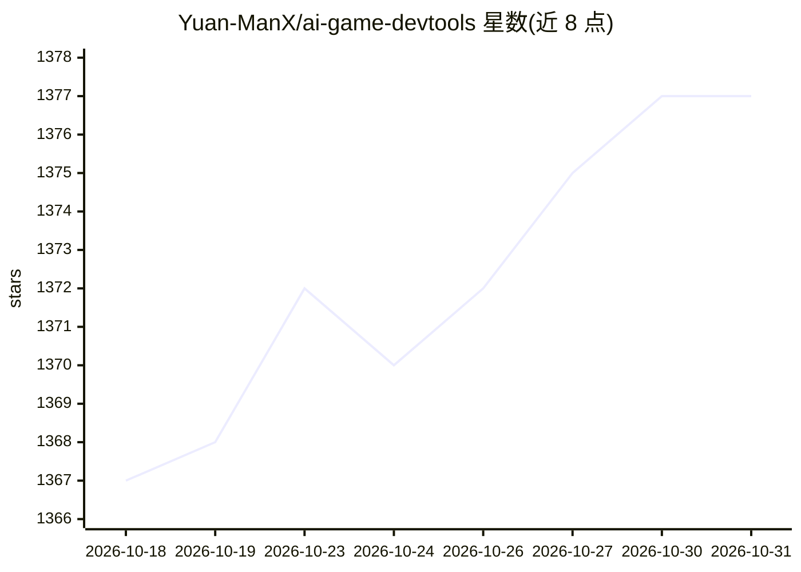

# Yuan-ManX/ai-game-devtools

⭐ 1,377 · JavaScript · MIT · 推送 2026-07-21 · [GitHub](https://github.com/Yuan-ManX/ai-game-devtools) · [官网](https://yuan-manx.github.io/ai-game-devtools/) · 个人维护 · 中文 README

**AI 游戏开发工具资源清单：收录 LLM、Agent、3D、音画等工具**

面向游戏开发者的 AI 工具聚合清单（awesome-list 形式），按 LLM/工具、World Model、Agent、代码、图像、纹理、Shader、3D 模型、动画、视频、音频、音乐、歌声与分析等类别组织条目。每条目以表格列出名称、来源、简介、论文链接与适配的游戏引擎（如 Unity、Unreal Engine）。README 本身不提供安装或运行方式，仅作为发现与导航资源使用。

## 筛选速览

| 维度 | 判定 | 备注 |
|---|---|---|
| AI 角色 | `ai-knowledge` | 知识聚合/清单类 |
| 许可风险 | `permissive` | MIT |
| 部署形态 | `None` |  |
| 模型依赖 | — | README 未给出锁定关系 |
| 硬件要求 | — | 无带数字的原话,不猜 |
| 安装摩擦 | `medium` | 含编译或系统依赖之一 |
| 成熟度 | — | 结构信号不足 |

## 能力要点

- 表格化条目：名称、简介、论文、游戏引擎、类型五列
- 覆盖 LLM、Agent、代码、图像、3D、音频等多类 AI 工具
- 部分条目标注 Unity / Unreal Engine 引擎适配
- 部分条目附带 arXiv 论文链接

## 适用场景

- 游戏开发者查找适配 Unity/Unreal 的 AI 工具
- 按类别浏览 AI 游戏开发生态中的模型与工具
- 通过论文链接追踪相关研究工作

## 场景标签

`精选清单` · 领域:学习与行业

## 证据(README 行号)

> L7: The ultimate resource hub for AI-powered game development tools. Discover cutting-edge LLMs, World Model, Agent, Cod
> L17: ## Project List
> L21: |Source|Description|Paper|Game Engine|Type|

## 星数曲线

2026-10-18 1,367 → 2026-10-31 1,377（+10）

---
*卡片 v1 · prompt 1.4 · 生成 2026-10-21 · 置信度 high · 依据 README sha `515aba85cedf` · [字段定义](../../DATASET.md)*
