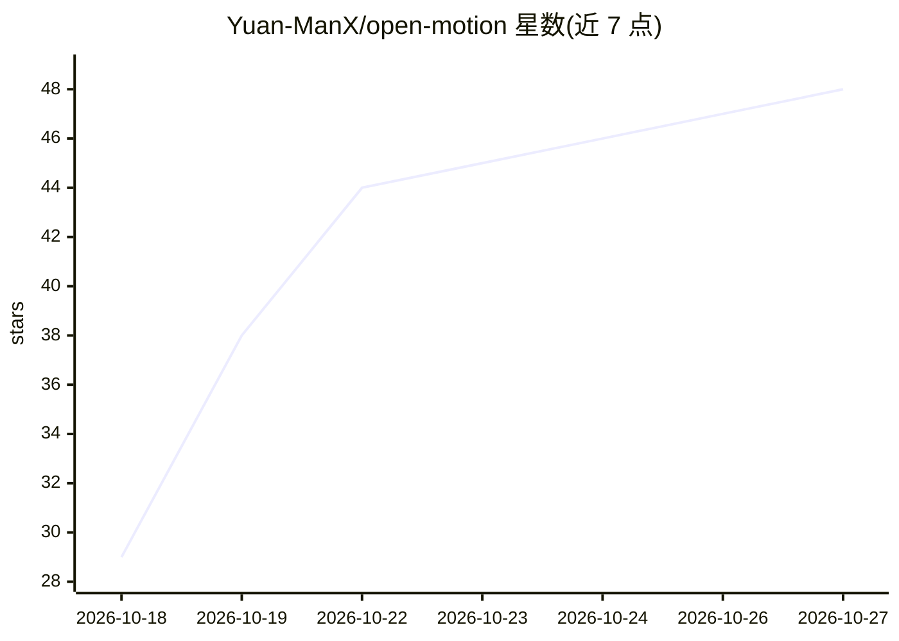

# Yuan-ManX/open-motion

⭐ 48 · TypeScript · MIT · 推送 2026-08-17 · [GitHub](https://github.com/Yuan-ManX/open-motion) · [官网](https://yuan-manx.github.io/open-motion/) · 个人维护 · 中文 README

**AI 原生动效运行时：网页与视频中的动画可对话编辑与复用**

面向动效设计与开发者的开源运行时，将 Web 实时画布与动效图形引擎结合：动画直接在 HTML 与视频中运行，无需导出管线。提供 340+ 工具覆盖 23 个系统（运动模糊、跟踪、抠像、粒子等），用户通过 Motion Agent 以自然语言编辑动画，外部 agent 可经 MCP 协议编程控制。运行时具备检查点回滚、FTS5 全文搜索、计划-执行编排，可将动效打包为 AI 可调用的 skill，导出 HTML/React/MP4 等格式。安装方式为 git clone 源码运行，MIT 许可。

## 筛选速览

| 维度 | 判定 | 备注 |
|---|---|---|
| AI 角色 | `ai-native` | 本体是模型或模型工具 |
| 许可风险 | `permissive` | MIT |
| 部署形态 | `None` |  |
| 模型依赖 | — | README 未给出锁定关系 |
| 硬件要求 | — | 无带数字的原话,不猜 |
| 安装摩擦 | `low` | 无编译、无系统依赖或容器化 |
| 成熟度 | — | 结构信号不足 |

## 能力要点

- 对话式动画编辑与手动时间轴控制并存，340+ 工具覆盖 23 个系统
- 检查点回滚、FTS5 全文搜索、计划-执行编排的运行时基础设施
- MCP-native：外部 AI agent 可编程控制运行时
- 动效可打包为 skill 复用，多格式导出（HTML/React/MP4/GIF/WebM）

## 适用场景

- 通过自然语言让 agent 制作和调整专业动效
- 将动效作为可复用 skill 在项目与团队间流转
- 让外部 AI agent 经 MCP 编程控制动效运行时

## 场景标签

`图像视频处理` · 领域:感知与多模态

## 证据(README 行号)

> L21: OpenMotion is a motion runtime — not a design tool with a preview window, but an execution surface where motion liv
> L29: What makes it a **runtime** — not just a tool — is the infrastructure underneath: checkpoint-rollback semantics mak

## 星数曲线

2026-10-18 29 → 2026-10-27 48（+19）

---
*卡片 v1 · prompt 1.4 · 生成 2026-10-25 · 置信度 high · 依据 README sha `5bee78eb993e` · [字段定义](../../DATASET.md)*
