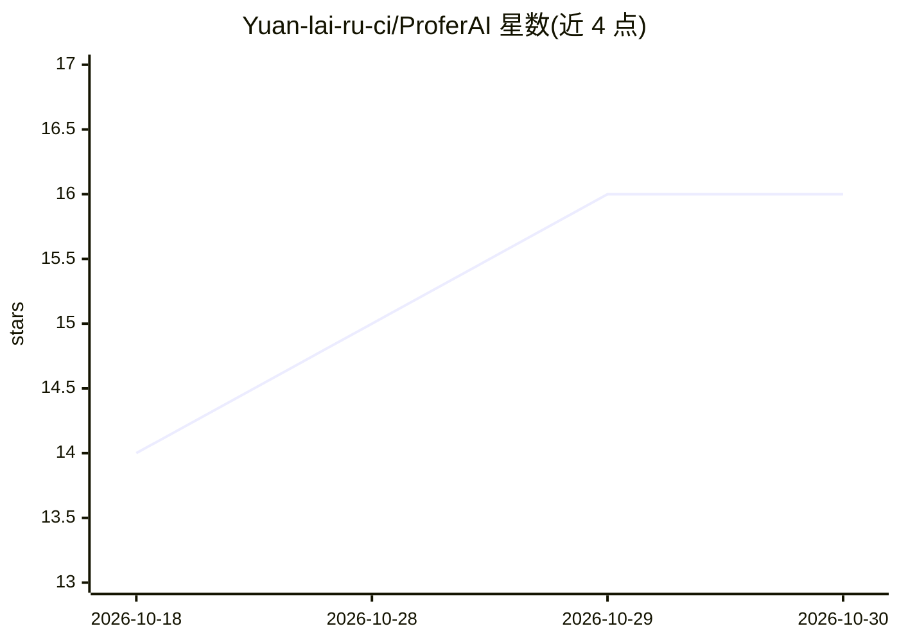

# Yuan-lai-ru-ci/ProferAI

⭐ 16 · TypeScript · AGPL-3.0 · 推送 2026-10-29 · [GitHub](https://github.com/Yuan-lai-ru-ci/ProferAI) · [官网](https://profer.cn/) · 组织维护 · 中文 README

**桌面端通用 AI Agent 应用：本地执行多步骤任务与定时自动化**

基于 Electron 的本地优先 AI Agent 桌面应用，双运行时（Claude Agent SDK + Pi Agent SDK）。区分聊天模式与 Agent 模式：将任务拆解为带依赖的子任务图并行执行，支持多子 Agent 会话协作、cron 式定时任务（含重试与产物记录）、手机端（Profer-pocket）通过局域网/VPN 触发与查看。支持 Anthropic、DeepSeek、Kimi、Ollama 等十余种模型接入。提供 macOS DMG 与 Windows 安装包；2026-10-11 起桌面端团队工作区运行时已移除，团队后端移至独立仓库。基于 Proma，AGPL-3.0 许可。

## 筛选速览

| 维度 | 判定 | 备注 |
|---|---|---|
| AI 角色 | `ai-native` | 本体是模型或模型工具 |
| 许可风险 | `viral` | AGPL-3.0 |
| 部署形态 | `None` |  |
| 模型依赖 | local-ok | 支持本地模型 |
| 硬件要求 | — | 无带数字的原话,不猜 |
| 安装摩擦 | `low` | 无编译、无系统依赖或容器化 |
| 成熟度 | — | 结构信号不足 |

## 能力要点

- 双运行时：Claude Agent SDK + Pi Agent SDK，任务拆解为依赖子图并行执行
- 多子 Agent 会话协作，各自独立工作区
- cron 式定时自动化任务，含成功/失败记录与重试逻辑
- 本地优先：工作区与会话数据留在本机，无需账号

## 适用场景

- 让 Agent 执行代码重构、依赖审计、文档生成等多步骤任务
- 定时生成团队周报、监控网页变更、夜间同步知识库
- 用手机触发或查看桌面 Agent 的工作进度

## 场景标签

`AI 助手` · 领域:对话与助手

## 证据(README 行号)

> L7: Built for people who need AI to *do* things, not just chat. Profer runs autonomous agents locally—planning multi-ste
> L26: Built on dual runtimes (Claude Agent SDK + Pi Agent SDK), Profer balances autonomy with control: agents work indepe
> L97: |Provider|Chat|Agent (Pi runtime)|Agent (Claude runtime)|Notes|

## 星数曲线

2026-10-18 14 → 2026-10-30 16（+2）

---
*卡片 v1 · prompt 1.4 · 生成 2026-10-30 · 置信度 high · 依据 README sha `fa436f8d7b9c` · [字段定义](../../DATASET.md)*
