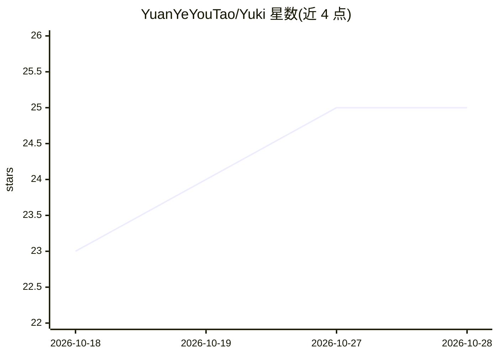

# YuanYeYouTao/Yuki

⭐ 25 · Python · NOASSERTION · 推送 2026-10-27 · [GitHub](https://github.com/YuanYeYouTao/Yuki) · 个人维护 · 中文 README

**自托管多平台社会化 AI Agent：持久身份、长期记忆与自主执行**

面向个人部署的社会化 AI Agent：通过 QQ、Telegram、飞书/Lark 和个人客户端持续参与对话，以自有数据库保存人物身份、记忆与任务，更换模型或账号后可延续使用。提供持久 Linux 工作区运行 Python/Node.js/Shell、支持长任务续跑、多模型协议（Chat Completions、Responses、Claude Messages、Gemini）与插件系统。安装途径为 Release 部署包/Docker 镜像（3.9.0）或从源码构建（4.0.0 开发基线，需 Python 3.12、uv 与 C 编译器）。项目附带 SWE-bench Lite 与 Terminal-Bench 2.0 评测报告。

## 筛选速览

| 维度 | 判定 | 备注 |
|---|---|---|
| AI 角色 | `ai-native` | 本体是模型或模型工具 |
| 许可风险 | `none` | NOASSERTION |
| 部署形态 | `None` |  |
| 模型依赖 | locked-api |  |
| 硬件要求 | — | 无带数字的原话,不猜 |
| 安装摩擦 | `low` | 无编译、无系统依赖或容器化 |
| 成熟度 | — | 结构信号不足 |

## 能力要点

- 人物/账号分离，身份、记忆与任务存于自有数据库，可跨模型、账号、网关迁移
- 持久 Linux 工作区：Bash/Python/Node.js/Git/编译工具，长任务可重启后续跑
- 多平台接入：QQ、Telegram、飞书/Lark、个人 API 与 ACP 客户端共用身份与记忆
- 可连接本机 Codex、Claude Code 或 ACP 编码 Agent 并回传进度

## 适用场景

- 在 QQ/Telegram/飞书等平台长期陪伴聊天并记住共同经历
- 让 Agent 在持久终端里维护项目、运行程序和执行定时任务
- 通过个人客户端配对设备、查看任务并向进行中的任务补充信息

## 场景标签

`聊天机器人` `Agent 记忆` · 领域:Agent 开发

## 证据(README 行号)

> L7:  一个在真实对话中持续存在的社会化 AI Agent
> L17: Yuki 是一个开源、自托管的社会化 AI Agent。她通过 QQ、Telegram、飞书、Lark 和个人客户端参与对话，记住人物、偏好和共同经历，也能在持久 Linux 环境里处理文件、运行程序、维护项目和执行定时任务。人物

## 星数曲线

2026-10-18 23 → 2026-10-28 25（+2）

---
*卡片 v1 · prompt 1.4 · 生成 2026-10-27 · 置信度 high · 依据 README sha `475dec679e68` · [字段定义](../../DATASET.md)*
