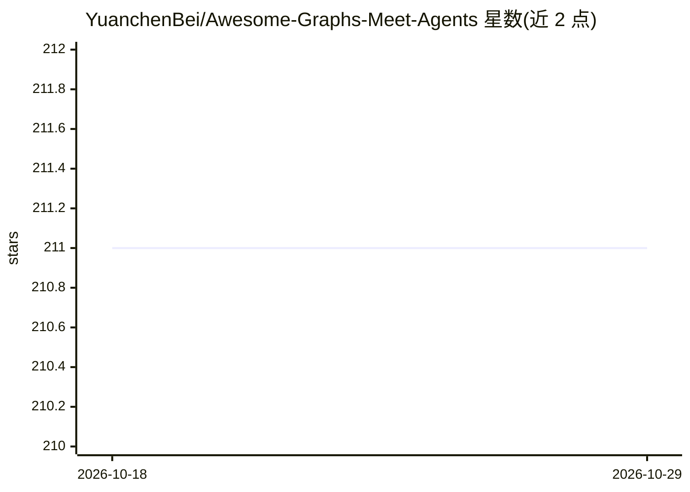

# YuanchenBei/Awesome-Graphs-Meet-Agents

⭐ 211 · MIT · 推送 2026-07-28 · [GitHub](https://github.com/YuanchenBei/Awesome-Graphs-Meet-Agents) · [官网](https://arxiv.org/pdf/2506.18019) · 个人维护

**图与智能体交叉领域的论文资源清单**

基于综述论文 Graphs Meet AI Agents: Taxonomy, Progress, and Future Opportunities 维护的策展清单，收录图赋能智能体与智能体辅助图学习两个方向的论文及代码链接。内容按分类组织：Graph for Agent Planning（任务推理、任务分解、任务决策搜索）、Graph for Agent Execution（工具使用、环境交互）、Graph for Agent Memory（记忆组织、检索、维护），另设 Agentic Graph Engineering 板块。条目多附论文链接，部分附代码仓库，通过 issue 或 PR 接受社区更新。

## 筛选速览

| 维度 | 判定 | 备注 |
|---|---|---|
| AI 角色 | `ai-knowledge` | 知识聚合/清单类 |
| 许可风险 | `permissive` | MIT |
| 部署形态 | `None` |  |
| 模型依赖 | — | README 未给出锁定关系 |
| 硬件要求 | — | 无带数字的原话,不猜 |
| 安装摩擦 | `low` | 无编译、无系统依赖或容器化 |
| 成熟度 | — | 结构信号不足 |

## 能力要点

- 基于一篇综述论文组织的策展论文清单
- 按 Planning/Execution/Memory 三大维度及子类组织条目
- 条目附论文链接，部分附代码仓库与 Demo
- 通过 issue/PR 接受社区贡献更新

## 适用场景

- 查找图结构增强 LLM agent 推理与规划的论文和代码
- 调研知识图谱辅助 LLM 推理方向的研究进展
- 了解 GraphRAG 与 agent 记忆相关的开源实现

## 场景标签

`精选清单` · 领域:学习与行业

## 证据(README 行号)

> L3: 📚 This repository contains a curated list of related papers on graphs & agents, based on the survey paper "**Graphs 
> L17: ## 🚀 Taxonomy

## 星数曲线

2026-10-18 211 → 2026-10-29 211（+0）

---
*卡片 v1 · prompt 1.4 · 生成 2026-10-22 · 置信度 high · 依据 README sha `0db1cdf1ec6b` · [字段定义](../../DATASET.md)*
