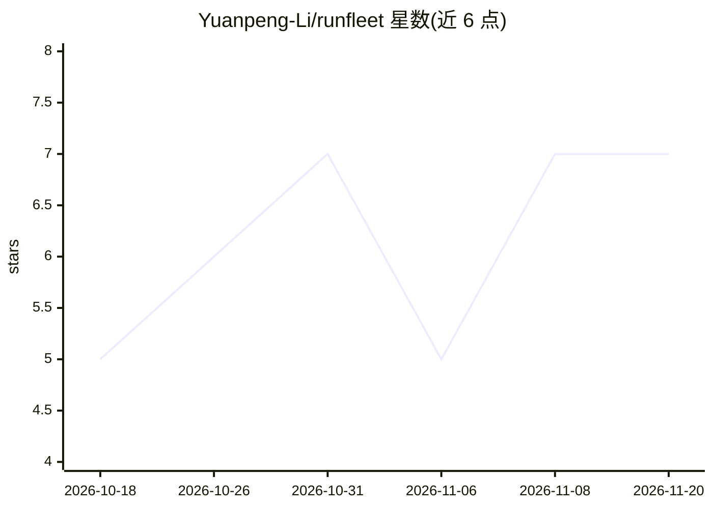

# Yuanpeng-Li/runfleet

⭐ 7 · Python · MIT · 推送 2026-11-18 · [GitHub](https://github.com/Yuanpeng-Li/runfleet) · [官网](https://yuanpeng-li.github.io/runfleet/) · 个人维护

**一个终端监控 Slurm 作业与 GPU 机器的工具，基于 SSH**

基于 Textual 的终端 TUI 应用：通过用户自身的 OpenSSH 配置轮询多个 Slurm 集群与 GPU 工作站，汇总运行/等待/失败作业、逐 GPU 利用率、实时 stdout 日志与失败原因（OOM、TIMEOUT 等标签），支持取消/重排等操作及通知。远端无需安装，仅调用 squeue/sacct/nvidia-smi 等已有命令；提供 --demo 模拟舰队、MCP server 与面向 Claude Code 等 agent 的 skill 安装。面向在多台机器上跑实验的科研与工程用户。

## 筛选速览

| 维度 | 判定 | 备注 |
|---|---|---|
| AI 角色 | `ai-enhanced` | 去掉 AI 部分产品仍成立 |
| 许可风险 | `permissive` | MIT |
| 部署形态 | `desktop` | 安装包/桌面程序 |
| 模型依赖 | — | README 未给出锁定关系 |
| 硬件要求 | — | 无带数字的原话,不猜 |
| 安装摩擦 | `low` | 无编译、无系统依赖或容器化 |
| 成熟度 | — | 结构信号不足 |

## 能力要点

- 一个键盘驱动的 TUI 汇总多集群作业队列、GPU 状态与失败原因
- 远端零安装，复用 ~/.ssh/config（ProxyJump、ControlMaster、2FA）
- 运行中作业的按需逐 GPU 读取与跨日志搜索（ctrl+f）
- runfleet skill install 为 Claude Code 等 agent 提供 Agent Skill

## 适用场景

- 在多个 Slurm 集群间查看自己作业的排队与 GPU 占用
- 排查作业失败原因并按提示调整 --time/--mem
- 同时监控实验室 GPU 工作站与集群

## 场景标签

 · 领域:开发运维/HPC 监控工具

## 证据(README 行号)

> L3: **All your Slurm jobs and GPU machines in one terminal.**
> L62: - **Nothing to install remotely.** It uses your OpenSSH client and `~/.ssh/config` as they are (ProxyJump,
> L209: `runfleet skill install` works for Claude Code, Codex, GitHub Copilot CLI, Gemini CLI, OpenCode, Cursor, Amp, Goos

## 星数曲线

2026-10-18 5 → 2026-11-20 7（+2）

---
*卡片 v1 · prompt 1.4 · 生成 2026-11-20 · 置信度 mid · 依据 README sha `def92b9e1f4a` · [字段定义](../../DATASET.md)*
