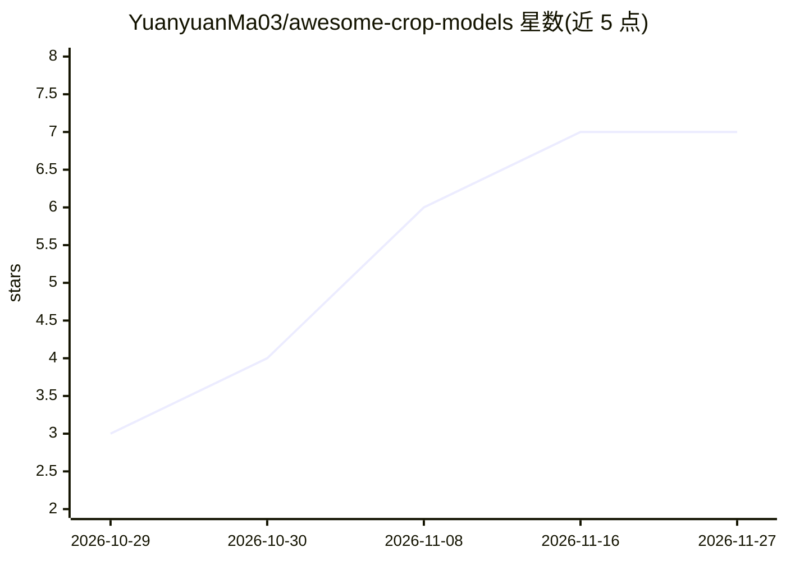

# YuanyuanMa03/awesome-crop-models

⭐ 7 · Python · MIT · 推送 2026-11-26 · [GitHub](https://github.com/YuanyuanMa03/awesome-crop-models) · [官网](https://yuanyuanma03.github.io/awesome-crop-models/) · 个人维护 · 中文 README

**面向农业科研的开源作物与农业过程模型策展清单**

以目录树形式组织 GitHub 上的开源作物与农业过程模型资源：按作物或过程类别与编程语言两层分类，覆盖作物生长模拟器、土壤/水分/养分/气候过程模型、运行框架与工具、应用研究及数据驱动的产量模型。清单经自动刷新维护，从 118,458 个 GitHub 仓库筛选收录 15,291 个仓库，标注许可证与 PR 状态，提供英文/简体中文双语页面与收录审核流程。清单声明仅为目录收录，不构成科学背书。

## 筛选速览

| 维度 | 判定 | 备注 |
|---|---|---|
| AI 角色 | `ai-knowledge` | 知识聚合/清单类 |
| 许可风险 | `permissive` | MIT |
| 部署形态 | `library` | 以包/库形式分发 |
| 模型依赖 | — | README 未给出锁定关系 |
| 硬件要求 | — | 无带数字的原话,不猜 |
| 安装摩擦 | `low` | 无编译、无系统依赖或容器化 |
| 成熟度 | — | 结构信号不足 |

## 能力要点

- 收录 15,291 个仓库，含 437 个作物模型与 10,826 个数据驱动模型
- 按作物/过程类别与编程语言双层组织，按 star 数排序
- 标注每个仓库的许可证与状态（含 archived 标记）
- 自动刷新维护，提供英文/简体中文双语页面

## 适用场景

- 查找特定作物或过程的可用开源模拟模型
- 按编程语言筛选作物模型实现（Fortran/Python/C++ 等）
- 调研作物模型生态并核查各项目的许可证

## 场景标签

`精选清单` · 领域:学习与行业

## 证据(README 行号)

> L3: **A curated map of open-source crop and agricultural process models on GitHub** crop or process → programming langua
> L11: > **15,291 repositories** · 437 crop models · 1,675 process models · 1,584 frameworks and tools · 769 applications 
> L42: ## Crop models

## 星数曲线

2026-10-29 3 → 2026-11-27 7（+4）

---
*卡片 v1 · prompt 1.4 · 生成 2026-11-20 · 置信度 mid · 依据 README sha `3b1d14ce936d` · [字段定义](../../DATASET.md)*
