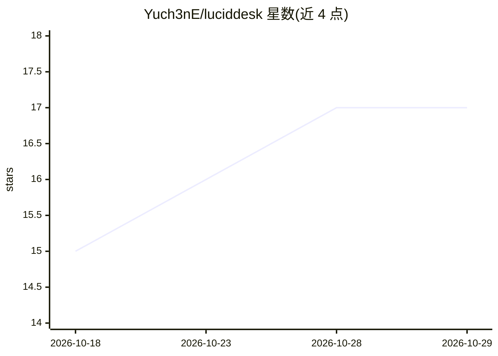

# Yuch3nE/luciddesk

⭐ 17 · Rust · MIT · 推送 2026-10-28 · [GitHub](https://github.com/Yuch3nE/luciddesk) · [官网](https://luciddesk.bbkingdom365.com) · 个人维护 · 中文 README

**Windows 桌面图标整理工具：面板分组、文件夹浏览、搜索预览与 Agent 联动**

用 Rust 编写的 Windows 桌面整理工具，把图标收纳进可合并为标签页、可排序的面板；文件夹面板直接浏览常用目录；可选接入 Everything 搜索与 PowerToys Peek/QuickLook 空格预览（需另行安装）。支持自动/手动备份、多语言界面。Agent 与 CLI 功能让外部 Agent 查询桌面、以 --dry-run 预览后执行整理，或用脚本管理面板。从 GitHub Releases 分发安装版、普通 ZIP 与便携 ZIP 三种包；支持 Windows 10/11 x64，ARM64 未完整验证。

## 筛选速览

| 维度 | 判定 | 备注 |
|---|---|---|
| AI 角色 | `ai-enhanced` | 去掉 AI 部分产品仍成立 |
| 许可风险 | `permissive` | MIT |
| 部署形态 | `desktop` | 安装包/桌面程序 |
| 模型依赖 | — | README 未给出锁定关系 |
| 硬件要求 | — | 无带数字的原话,不猜 |
| 安装摩擦 | `low` | 无编译、无系统依赖或容器化 |
| 成熟度 | — | 结构信号不足 |

## 能力要点

- 面板收纳图标并合并为标签页，多种排列与视图
- 文件夹面板浏览常用目录并自动刷新
- 配套 CLI 与 Skill，外部 Agent 可查询并以 --dry-run 预览整理
- 三种发布包（安装版/普通 ZIP/便携 ZIP），设置与布局可备份恢复

## 适用场景

- 把杂乱桌面图标分组收纳成面板
- 在桌面上直接浏览常用文件夹
- 让外部 Agent 或脚本协助整理桌面面板

## 场景标签

 · 领域:桌面工具

## 证据(README 行号)

> L19: LucidDesk 是一款免费、开源的 Windows 桌面整理工具。用面板收纳文件和快捷方式，把常用目录放在桌面上，随时搜索和预览文件；也可以通过配套 CLI 与 Skill，让外部 Agent 协助整理。
> L57: |Agent 与 CLI|让外部 Agent 查询桌面、预览整理方案并执行，也可编写脚本管理面板和备份|
> L83: 修改前先查看预览，确认后再应用；命令行修改使用 `--dry-run` 只预览。完整操作见 CLI 指南和官网 Agent 指南。使用外部 Agent 时，文件名、路径等信息可能发送给其服务商，详见隐私说明。

## 星数曲线

2026-10-18 15 → 2026-10-29 17（+2）

---
*卡片 v1 · prompt 1.4 · 生成 2026-10-29 · 置信度 high · 依据 README sha `59fd8c70a054` · [字段定义](../../DATASET.md)*
