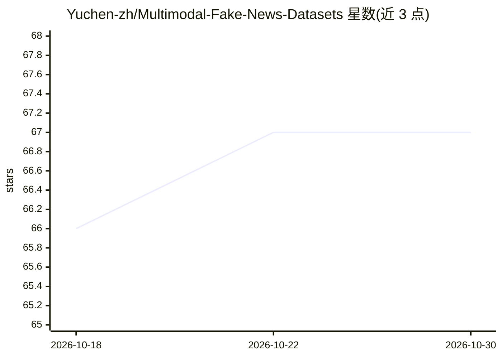

# Yuchen-zh/Multimodal-Fake-News-Datasets

⭐ 67 · Python · 推送 2026-09-03 · [GitHub](https://github.com/Yuchen-zh/Multimodal-Fake-News-Datasets) · 个人维护

**多模态假新闻数据集编目：33个数据集的结构化元数据与选型指南**

面向多模态假新闻检测（MFND/MMD）研究的数据集清单仓库：收录 33 个数据集/基准（21 个核心 + 12 个相关），每个条目附论文、官方仓库与数据获取链接，并在 catalog/datasets.yaml 与 datasets/datasets.csv 中存储任务、模态、语言、领域、标签类型、数据来源等结构化元数据。提供按年份、模态、研究类别的可视化汇总，以及按研究方向（如脱语境检测、事实核查、短视频假新闻、GenAI 鲁棒性）的数据集推荐表。区分六类数据来源（真实/合成/混合等）。仓库仅汇总链接，不重新分发数据集文件。

## 筛选速览

| 维度 | 判定 | 备注 |
|---|---|---|
| AI 角色 | `ai-knowledge` | 知识聚合/清单类 |
| 许可风险 | `none` | — |
| 部署形态 | `None` |  |
| 模型依赖 | — | README 未给出锁定关系 |
| 硬件要求 | — | 无带数字的原话,不猜 |
| 安装摩擦 | `low` | 无编译、无系统依赖或容器化 |
| 成熟度 | — | 结构信号不足 |

## 能力要点

- 33 个数据集（21 核心 + 12 相关），附论文、仓库与获取链接
- YAML/CSV 结构化元数据可程序化复用与统计分析
- 按 12 个研究方向的选型推荐表与特征对比矩阵
- 区分 6 类数据来源（真实/策展/合成配对/操纵/混合/GenAI）

## 适用场景

- 为假新闻检测研究挑选合适的数据集与基准
- 按模态、语言、领域等条件筛选和对比候选数据集
- 程序化读取目录元数据做统计分析

## 场景标签

`精选清单` · 领域:学习与行业

## 证据(README 行号)

> L1: # 📰 Multimodal Fake News Datasets
> L3: > A research-oriented collection of **multimodal fake news / misinformation / rumor / disinformation / fact-checking
> L10: This collection supports research on **Multimodal Fake News Detection (MFND/MMD)** and related topics. It brings to

## 星数曲线

2026-10-18 66 → 2026-10-30 67（+1）

---
*卡片 v1 · prompt 1.4 · 生成 2026-10-24 · 置信度 high · 依据 README sha `fd248b2b8fa5` · [字段定义](../../DATASET.md)*
