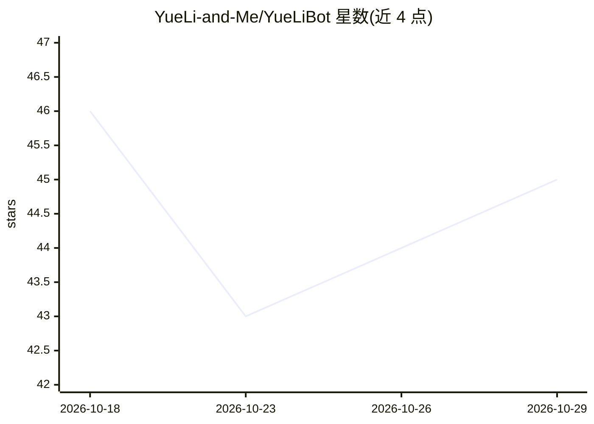

# YueLi-and-Me/YueLiBot

⭐ 45 · Python · AGPL-3.0 · 推送 2026-10-28 · [GitHub](https://github.com/YueLi-and-Me/YueLiBot) · [官网](https://docs.yuelibot.org/) · 个人维护 · 中文 README

**LLM 驱动的 QQ 陪伴智能体：有记忆、性格与作息**

月璃是一个由 LLM 驱动的可交互智能体，面向希望获得拟人陪伴的用户：她具备长期记忆与遗忘机制、随相处变化的关系设定、看气氛发言的群聊节奏控制、学习群内口癖与黑话理解等能力，并支持接入 QQ（通过 NapCat 或 SnowLuma 协议端）。提供 Windows 桌宠与管理面板，用 uv 安装后端依赖、npm 构建前端后运行 bot.py 启动；首次启动需同意用户协议并填写 providers.toml 中的 api_key。接入 QQ 存在账号风险，官方建议使用小号；许可证为 AGPL-3.0，网络提供服务需开源衍生作品。

## 筛选速览

| 维度 | 判定 | 备注 |
|---|---|---|
| AI 角色 | `ai-native` | 本体是模型或模型工具 |
| 许可风险 | `viral` | AGPL-3.0 |
| 部署形态 | `None` |  |
| 模型依赖 | — | README 未给出锁定关系 |
| 硬件要求 | — | 无带数字的原话,不猜 |
| 安装摩擦 | `low` | 无编译、无系统依赖或容器化 |
| 成熟度 | — | 结构信号不足 |

## 能力要点

- 长期记忆与遗忘机制：随口提过的事会记住并慢慢淡忘
- 群聊氛围感知：热闹时不抢话，没人时不会持续刷存在感
- 学习群内口癖（需用户认可后使用）与圈内黑话理解
- 支持 NapCat / SnowLuma 两种 QQ 协议端接入

## 适用场景

- 在 QQ 群里有一个记得住人、有性格的陪伴智能体
- 日常聊天中获得拟人化、非分点罗列式的回复
- 在 Windows 桌面上以桌宠形式与之互动

## 场景标签

`聊天机器人` · 领域:对话与助手

## 证据(README 行号)

> L12: 月璃是一个由 LLM 驱动的可交互智能体。
> L14: 她不仅仅是一个机器人，她有记忆、有性格、有自己的日程和作息，是一个像真实人类一样陪伴着你的数字生命。
> L67: - NapCat

## 星数曲线

2026-10-18 46 → 2026-10-29 45（-1）

---
*卡片 v1 · prompt 1.4 · 生成 2026-10-25 · 置信度 high · 依据 README sha `5e5e1d96b869` · [字段定义](../../DATASET.md)*
