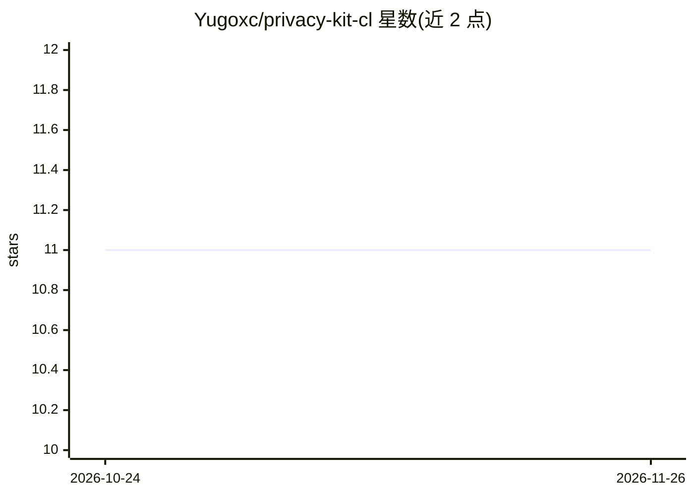

# Yugoxc/privacy-kit-cl

⭐ 11 · Python · MIT · 推送 2026-07-06 · [GitHub](https://github.com/Yugoxc/privacy-kit-cl) · [官网](https://www.npmjs.com/package/privacy-kit-cl) · 组织维护

**面向智利 Ley 21.719 合规的开发库：LLM 前脱敏 PII、管理 ARCOP 权利**

Python 与 Node.js 双实现（同一 API）的合规工具库，将 Ley 21.719 数据保护要求拆为 consent、redaction、rights、retention、transfers、audit、notice 七个组件，以声明式配置加包装调用的方式嵌入现有系统。核心机制是在个人数据到达 LLM 或第三方前检测并匿名化 PII，仅在返回客户端时还原；可选 admin 模块提供 REST API 与 UI 管理同意、传输、审计记录与 ROPA。作者声明当前为功能骨架（stubs），并提示非法律咨询。

## 筛选速览

| 维度 | 判定 | 备注 |
|---|---|---|
| AI 角色 | `ai-enhanced` | 去掉 AI 部分产品仍成立 |
| 许可风险 | `permissive` | MIT |
| 部署形态 | `library` | 以包/库形式分发 |
| 模型依赖 | — | README 未给出锁定关系 |
| 硬件要求 | — | 无带数字的原话,不猜 |
| 安装摩擦 | `low` | 无编译、无系统依赖或容器化 |
| 成熟度 | `idea` | |

## 能力要点

- PII 在进入 LLM/第三方前掩码、响应时还原（redaction）
- ARCOP 权利处理器与不可变审计日志
- 声明式 YAML/JSON 配置驱动合规策略，核心零外部依赖
- 可选 admin 模块：REST API + UI，支持被遗忘权一键执行

## 适用场景

- 给 LLM 客服机器人加一层发送前 PII 脱敏与第三方传输记录
- 为处理智利用户数据的系统落实同意采集与删除权流程
- 搭建内部管理面板查询数据主体信息并执行被遗忘权

## 场景标签

 · 领域:数据隐私/合规

## 证据(README 行号)

> L11: Módulo **independiente y reutilizable** para cumplir la **Ley 21.719** (Protección de Datos Personales de Chile) en
> L123: Aplica a **cualquier sistema que trate datos personales** (RUT, nombre, teléfono, email, dirección…), tenga IA o n
> L125: - **Con IA / chat** (bots y agentes con LLM): el foco es `redaction` — enmascarar la PII antes de enviarla al mode

## 星数曲线

2026-10-24 11 → 2026-11-26 11（+0）

---
*卡片 v1 · prompt 1.4 · 生成 2026-11-18 · 置信度 high · 依据 README sha `ebe876233ce4` · [字段定义](../../DATASET.md)*
