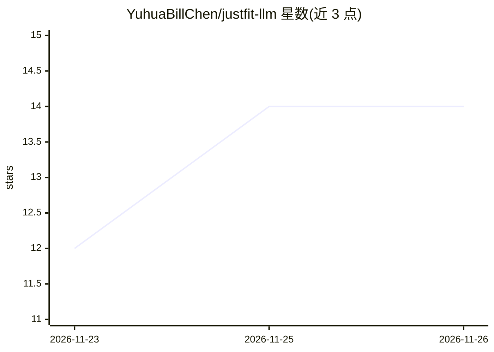

# YuhuaBillChen/justfit-llm

⭐ 14 · C++ · Apache-2.0 · 推送 2026-11-25 · [GitHub](https://github.com/YuhuaBillChen/justfit-llm) · [官网](https://yuhuachen.com/justfit) · 个人维护

**在 24GB Mac 上运行 Qwen3.8-27B 全 256K 上下文的本地推理服务**

面向 Apple silicon 的长上下文本地 LLM 服务程序：在 24GB 统一内存的 Mac 上以原生可执行文件（Rust/C++/Metal/Swift）运行 27B 语言与视觉模型，推理时无需 Python。首次 serve 时从 Hugging Face 下载 4bit 检查点、DFlash2 草稿与 ANE 视觉程序，提供 OpenAI 兼容 API、草稿树解码、多轮状态复用与请求沙箱。要求 macOS 27.0+，约 22GB 磁盘；从 Splash 1.3.0 派生。

## 筛选速览

| 维度 | 判定 | 备注 |
|---|---|---|
| AI 角色 | `ai-ecosystem` | LLM/agent 周边工具 |
| 许可风险 | `permissive` | Apache-2.0 |
| 部署形态 | `library` | 以包/库形式分发 |
| 模型依赖 | — | README 未给出锁定关系 |
| 硬件要求 | — | 无带数字的原话,不猜 |
| 安装摩擦 | `low` | 无编译、无系统依赖或容器化 |
| 成熟度 | — | 结构信号不足 |

## 能力要点

- 提供 OpenAI 兼容 API 与 vLLM/SGLang 兼容的 token-in/token-out 接口
- 草稿树解码：一次验证多条候选续写
- 多轮请求复用已完成状态，仅对新尾部 prefill
- 引擎与原生 worker 沙箱化运行（无出站网络）

## 适用场景

- 在 24GB Mac 上本地运行带 256K 上下文的 27B 模型
- 为本地 Agent 与聊天应用提供 OpenAI 兼容 API
- 本地处理长文档的多轮对话与视觉输入

## 场景标签

`推理引擎` · 领域:训练与推理

## 证据(README 行号)

> L9: JustFit serves a 27B language-and-vision model (Qwen3.8-27B) on Apple silicon
> L18: ~/.justfit/bin/justfit serve
> L59: - `return_token_ids` (vLLM/SGLang-compatible token-in/token-out), crash-request

## 星数曲线

2026-11-23 12 → 2026-11-26 14（+2）

---
*卡片 v1 · prompt 1.4 · 生成 2026-11-23 · 置信度 high · 依据 README sha `d8b7d5982c4f` · [字段定义](../../DATASET.md)*
