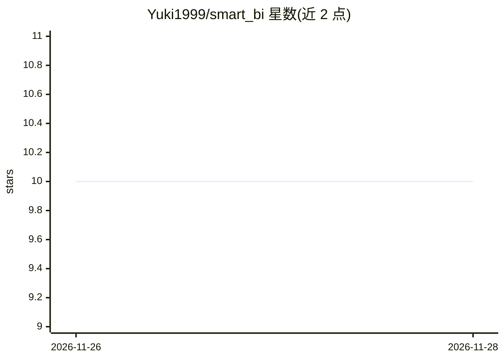

# Yuki1999/smart_bi

⭐ 10 · Python · MIT · 推送 2026-10-14 · [GitHub](https://github.com/Yuki1999/smart_bi) · [官网](https://github.com/Yuki1999/smart_bi#readme) · 个人维护 · 中文 README

**企业级 AI 问数 BI 平台：自然语言分析+语义层+治理**

Smart BI 将连接器接入、语义数据集、可信指标、自然语言问数、看板、大屏、预警、行动闭环、RBAC 权限与审计日志整合为一个 BI 产品。AI 问数链路为：自然语言经已发布数据集、可信指标、字段语义与 SQL 安全护栏生成查询结果；另含页面级 Agent 辅助导航与受控操作。技术栈为 Vue 3 前端、FastAPI 后端、PostgreSQL 存储、可选 Apache Doris OLAP 加速，通过 Docker Compose 部署，默认自动导入 mock_data.sql 演示数据。

## 筛选速览

| 维度 | 判定 | 备注 |
|---|---|---|
| AI 角色 | `ai-native` | 本体是模型或模型工具 |
| 许可风险 | `permissive` | MIT |
| 部署形态 | `self-host` | docker 或自建部署 |
| 模型依赖 | — | README 未给出锁定关系 |
| 硬件要求 | — | 无带数字的原话,不猜 |
| 安装摩擦 | `low` | 无编译、无系统依赖或容器化 |
| 成熟度 | `idea` | |

## 能力要点

- 自然语言问数：SQL 生成、多轮上下文、图表建议与结果复用
- 指标认证流程、血缘与提示词同步的可信指标治理
- 多租户 RBAC、RLS 基础、审计日志与安全删除保护
- AI 经 OpenAI 兼容 API 接入 OpenAI、Azure OpenAI、本地网关等模型

## 适用场景

- 让业务人员用自然语言查数据但受权限与指标口径约束
- 在现有数据源之上建统一语义层和可信指标中心
- 把问数结果沉淀为看板、预警、报告和行动项
- 私有化部署企业内部数据分析平台

## 场景标签

`数据分析` · 领域:效率与自动化

## 证据(README 行号)

> L24: Smart BI 是一个企业级开源 AI-Native 商业智能平台。它将连接器接入、语义数据集、可信指标、AI 问数、看板、大屏、预警、行动闭环、权限和审计整合为一个产品。
> L30: Smart BI 的核心卖点不是把一个聊天框放进 BI，而是把 AI 放在数据资产生产、治理、分析和行动闭环的主链路中。传统 BI 往往先要求数据团队建模、业务用户拖拽分析、再由人工解释和分发结果；Smart BI 则围绕“自然语
> L96: |AI|OpenAI 兼容 API|支持 OpenAI、Azure OpenAI、本地网关和兼容模型。|

## 星数曲线

2026-11-26 10 → 2026-11-28 10（+0）

---
*卡片 v1 · prompt 1.4 · 生成 2026-11-26 · 置信度 mid · 依据 README sha `c8c40b7e23e1` · [字段定义](../../DATASET.md)*
