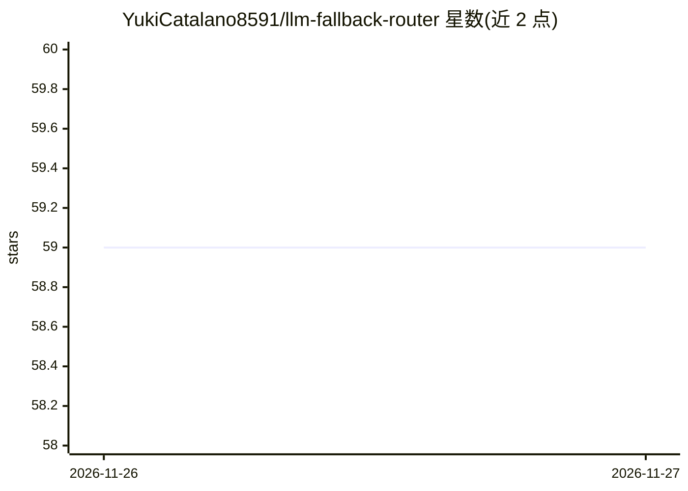

# YukiCatalano8591/llm-fallback-router

⭐ 59 · C++ · MIT · 推送 2026-11-25 · [GitHub](https://github.com/YukiCatalano8591/llm-fallback-router) · 个人维护

**面向免费层 LLM 的路由与故障回退工具**

Windows x64 便携版 LLM 运行时：将请求路由到多个免费层服务商，并在失败时自动回退。提供预构建 zip 包，解压后运行安装程序即可，无需编译器与外部依赖；配置基于 config/settings.json，支持热重载、原子化 JSON 状态与崩溃回滚、stderr 遥测开关。自称 OpenAI chat 格式兼容，可作为任何该格式客户端的后端。也提供 CMake 从源码构建路径。

## 筛选速览

| 维度 | 判定 | 备注 |
|---|---|---|
| AI 角色 | `ai-ecosystem` | LLM/agent 周边工具 |
| 许可风险 | `permissive` | MIT |
| 部署形态 | `desktop` | 安装包/桌面程序 |
| 模型依赖 | locked-api |  |
| 硬件要求 | — | 无带数字的原话,不猜 |
| 安装摩擦 | `medium` | 含编译或系统依赖之一 |
| 成熟度 | `idea` | |

## 能力要点

- 预构建便携包，解压即运行，零外部依赖
- JSON 配置热重载，无需重启生效
- 接入 Groq/Gemini/OpenRouter 免费层等 15+ 服务商
- OpenAI chat 格式 drop-in 兼容，含 SDK 客户端

## 适用场景

- 在多个免费 LLM 服务商之间自动切换与回退
- 为已有 OpenAI 格式客户端提供本地路由端点
- 不装编译环境直接运行 LLM 代理工具

## 场景标签

`模型网关` · 领域:Agent 开发

## 证据(README 行号)

> L18: **LlmFallbackRouter — llm-router-free — router and fallback in one tool** (`llm-fallback-router`) is a portable Win
> L59: Everything from Groq and Gemini free tiers to OpenRouter's free models — 15+ on day one.
> L67: Yes — drop-in for any client that speaks the OpenAI chat format, including SDKs.

## 星数曲线

2026-11-26 59 → 2026-11-27 59（+0）

---
*卡片 v1 · prompt 1.4 · 生成 2026-11-26 · 置信度 high · 依据 README sha `6e0c1acdedd5` · [字段定义](../../DATASET.md)*
