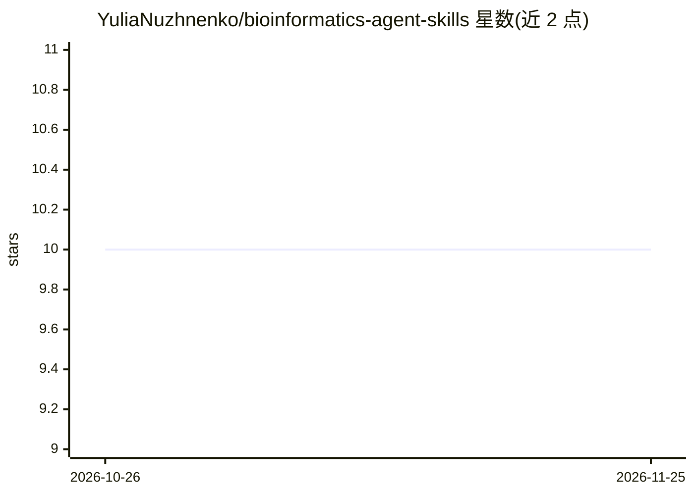

# YuliaNuzhnenko/bioinformatics-agent-skills

⭐ 10 · Python · MIT · 推送 2026-08-08 · [GitHub](https://github.com/YuliaNuzhnenko/bioinformatics-agent-skills) · 个人维护

**生物信息学 AI Agent 技能集与工具规范集合**

面向生物信息学、基因组学、结构生物学、宏基因组学与 AI 药物发现的 Agent 技能集合：收录 12 个 SKILL.md 格式技能，覆盖单细胞分析、差异表达、变异注释、QSAR、分子对接等领域，每个技能绑定 Scanpy、RDKit、GATK4、Ensembl VEP 等具体工具与 API 规范。设计目标是将 Cursor、Claude Code、Google Antigravity、OpenAI Codex、Gemini CLI、LangChain 等 LLM Coding Agent 转化为领域专家型 AI Scientist。提供 npx、GitHub CLI 与 git clone 三种安装方式，附 schema 校验脚本与执行示例。

## 筛选速览

| 维度 | 判定 | 备注 |
|---|---|---|
| AI 角色 | `ai-knowledge` | 知识聚合/清单类 |
| 许可风险 | `permissive` | MIT |
| 部署形态 | `library` | 以包/库形式分发 |
| 模型依赖 | — | README 未给出锁定关系 |
| 硬件要求 | — | 无带数字的原话,不猜 |
| 安装摩擦 | `low` | 无编译、无系统依赖或容器化 |
| 成熟度 | — | 结构信号不足 |

## 能力要点

- 12 个 SKILL.md 技能，覆盖 12 个生物信息学子领域
- 每个技能绑定具体工具规范（Scanpy、RDKit、GATK4、Ensembl VEP 等）
- npx/gh skill/git clone 三种安装方式
- 附技能校验脚本 scan_skills.py 与 schema 验证

## 适用场景

- 为 Cursor 或 Claude Code 配置单细胞 RNA-seq 分析技能
- 在 LLM agent 中执行 VCF 变异注释与药物映射工作流
- 为计算生物学项目扩展自定义 SKILL.md 定义

## 场景标签

`科研工具` · 领域:学习与行业

## 证据(README 行号)

> L9: An open-source collection of specialized **AI Agent Skills, Tool Specifications, and Prompt Protocols** for **Bioinf
> L13: ## 📋 Available Agent Skills Directory

## 星数曲线

2026-10-26 10 → 2026-11-25 10（+0）

---
*卡片 v1 · prompt 1.4 · 生成 2026-11-20 · 置信度 high · 依据 README sha `e398a92780d9` · [字段定义](../../DATASET.md)*
