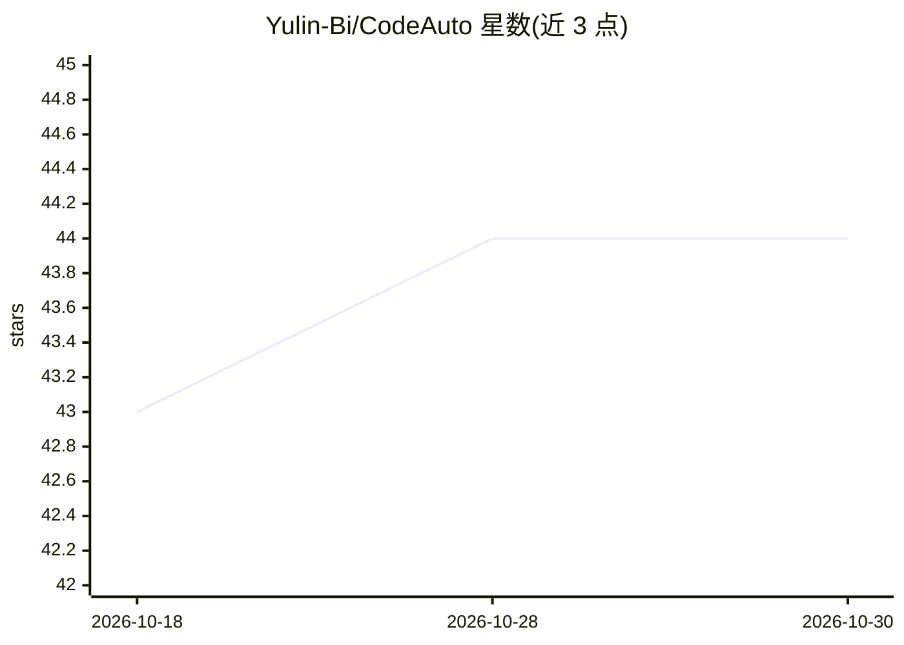

# Yulin-Bi/CodeAuto

⭐ 44 · Java · MIT · 推送 2026-09-29 · [GitHub](https://github.com/Yulin-Bi/CodeAuto) · 个人维护 · 中文 README

**Java 21 的 AI 编程代理运行时，含 CLI/TUI/Web 工作台**

基于 Java 21 与 Maven 构建的 Coding Agent 运行时，面向在 JVM 生态中构建与扩展编程代理的开发者。实现流式模型回复、工具调用、上下文压缩与取消重试的 Agent Loop；工程修改带权限审批、Diff 预览、Git 检查点、撤销与 Worktree 管理。提供普通 CLI、全屏 TUI 和单进程 Web 工作台（会话历史、Markdown 对话、评估图表、文件变更预览），前端由 Java 服务直接托管，无需额外 Node/Vite 服务。支持会话持久化、项目指令、Skills、MCP、Reflexion 自反思与 ACE Bullet 经验记忆。

## 筛选速览

| 维度 | 判定 | 备注 |
|---|---|---|
| AI 角色 | `ai-native` | 本体是模型或模型工具 |
| 许可风险 | `permissive` | MIT |
| 部署形态 | `None` |  |
| 模型依赖 | — | README 未给出锁定关系 |
| 硬件要求 | — | 无带数字的原话,不猜 |
| 安装摩擦 | `medium` | 含编译或系统依赖之一 |
| 成熟度 | — | 结构信号不足 |

## 能力要点

- 完整 Agent Loop：流式回复、工具调用、上下文压缩、取消与重试
- 权限审批、统一 Diff 预览、Git 检查点、撤销与 Worktree 管理
- CLI、全屏 TUI 与单进程 Web 工作台三种交互方式
- Skills、MCP、Reflexion 自反思与 ACE Bullet 经验记忆

## 适用场景

- 在 JVM 项目中通过对话让 AI 代理修改代码并审查 Diff
- 以 CLI/TUI/Web 三种方式跟踪与恢复会话分支和 Git 状态
- 基于统一注册机制扩展自定义工具构建自己的 Coding Agent

## 场景标签

`编码 Agent` `Agent 框架` · 领域:Agent 开发

## 证据(README 行号)

> L3: CodeAuto 是一个基于 Java 21 的 AI 编程代理运行时，面向希望在 JVM 生态中构建、学习和扩展 Coding Agent 的开发者。它同时提供 CLI、全屏 TUI 和单进程 Web 工作台，代码修改、工具调用、
> L8: - **完整 Agent Loop**：支持流式模型回复、工具调用、上下文压缩、取消与重试。

## 星数曲线

2026-10-18 43 → 2026-10-30 44（+1）

---
*卡片 v1 · prompt 1.4 · 生成 2026-10-25 · 置信度 mid · 依据 README sha `e83136cdd9b1` · [字段定义](../../DATASET.md)*
