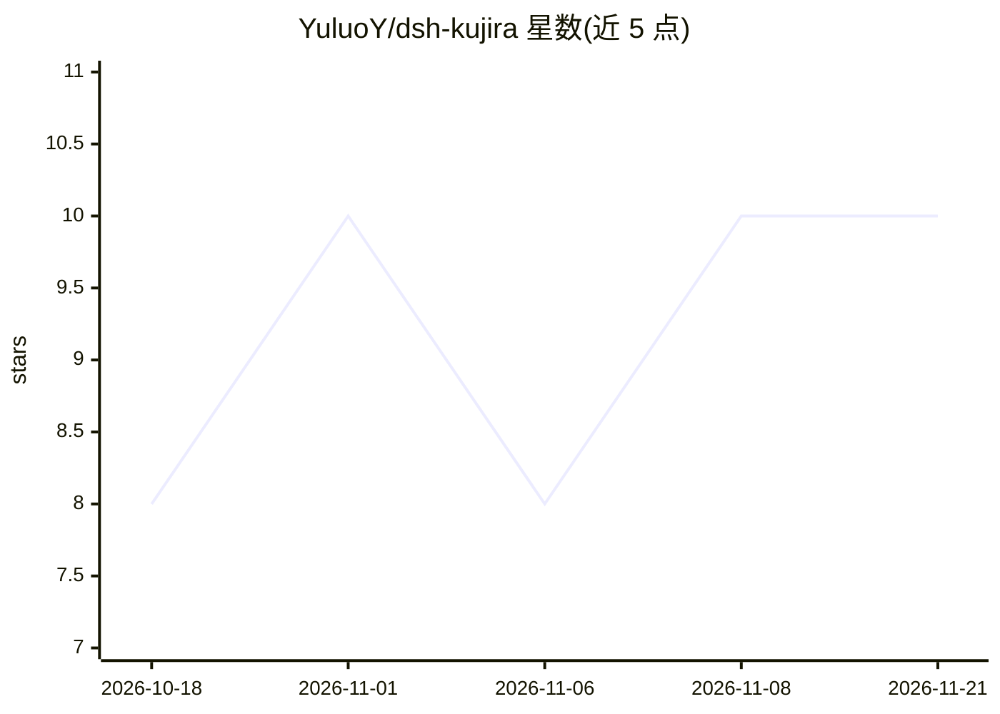

# YuluoY/dsh-kujira

⭐ 10 · JavaScript · NOASSERTION · 推送 2026-09-29 · [GitHub](https://github.com/YuluoY/dsh-kujira) · 个人维护 · 中文 README

**DeepSeek Harness Web 的鲸鱼娘桌宠插件：监控任务与费用并峰谷调度**

以 DSH 插件形式安装的桌面宠物界面：显示当前任务、计划与子代理状态，输入框旁展示会话费用与账户余额（余额复用宿主 DSH 的 DEEPSEEK_API_KEY 凭据服务读取）。提供峰价暂停、谷价续跑的调度开关（默认关闭），以及 130 段动画的互动养成系统，运行时不调用模型生成回应。可选 Electron 桌面模式与浏览器插件同步数据；库存使用 SQLite 事务。依赖 Node.js 22.13+、pnpm 与可正常运行的 DSH Web。

## 筛选速览

| 维度 | 判定 | 备注 |
|---|---|---|
| AI 角色 | `ai-ecosystem` | LLM/agent 周边工具 |
| 许可风险 | `none` | NOASSERTION |
| 部署形态 | `None` |  |
| 模型依赖 | locked-api |  |
| 硬件要求 | — | 无带数字的原话,不猜 |
| 安装摩擦 | `low` | 无编译、无系统依赖或容器化 |
| 成熟度 | — | 结构信号不足 |

## 能力要点

- 任务进展面板：操作、计划与子代理状态，可跳转对应会话
- 峰谷调度：峰价暂停、谷价续跑，作用于 Agent 步骤边界
- 余额查询复用 DSH 凭据服务，密钥只在宿主使用
- 130 段透明动画养成，可选 Electron 桌面模式与鼠标穿透/置顶

## 适用场景

- 使用 DeepSeek Harness Web 时在桌面查看任务进度与费用
- 在电价峰谷时段自动暂停和恢复代理任务
- 想要一个带互动养成的 AI 会话桌宠

## 场景标签

`LLM 可观测性` · 领域:评测与运维

## 证据(README 行号)

> L3: **DeepSeek Harness Web 桌宠插件** — 查看任务进度、会话费用和账户余额，支持峰谷调度、互动养成与独立桌面模式。
> L15: - **任务进展** — 显示当前操作、计划和子代理状态，展开查看结果与文件，通过入口跳转到对应会话。
> L16: - **峰谷调度** — 同一 DSH 服务中的主代理和子代理，峰价暂停、谷价续跑。主动发送或单独继续可放行当前任务树至本段峰价结束；默认关闭，在设置中开启。

## 星数曲线

2026-10-18 8 → 2026-11-21 10（+2）

---
*卡片 v1 · prompt 1.4 · 生成 2026-11-20 · 置信度 high · 依据 README sha `7f5a4b9e7bc2` · [字段定义](../../DATASET.md)*
