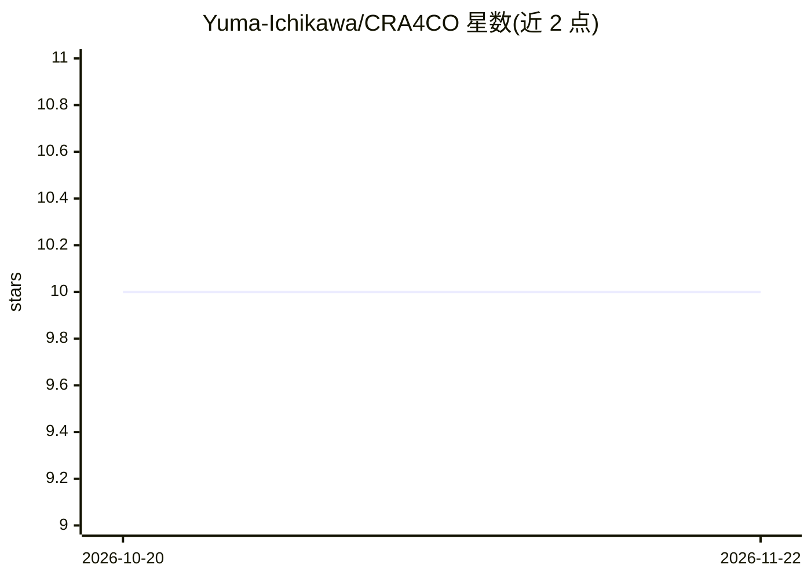

# Yuma-Ichikawa/CRA4CO

⭐ 10 · Jupyter Notebook · BSD-3-Clause-Clear · 推送 2026-04-18 · [GitHub](https://github.com/Yuma-Ichikawa/CRA4CO) · [官网](https://proceedings.neurips.cc/paper_files/paper/2024/hash/54191f424e9013fc1d7b923f6e45dff4-Abstract-Conference.html) · 个人维护

**组合优化的无监督神经求解方法 CRA 的 PyTorch 复现库**

NeurIPS 2024 论文 Controlling Continuous Relaxation for Combinatorial Optimization 的官方 PyTorch 实现。CRA（Continuous Relaxation Annealing）是无监督学习求解器的一种训练方法：通过动态调整惩罚项，从平滑非凸性过渡到强制离散性，免除人工取整步骤。仓库以图最大独立集（MIS）为例给出 PI-GNN 与 CRA-PI-GNN 的逐步训练代码，依赖 DGL 2.1.0 与 Python 3.11.11，按 BSD 3-Clause 发布。README 声明本仓库冻结为 NeurIPS 版本以供论文精确复现，后续开发转向 QQA4CO。

## 筛选速览

| 维度 | 判定 | 备注 |
|---|---|---|
| AI 角色 | `ai-native` | 本体是模型或模型工具 |
| 许可风险 | `viral` | BSD-3-Clause-Clear |
| 部署形态 | `library` | 以包/库形式分发 |
| 模型依赖 | — | README 未给出锁定关系 |
| 硬件要求 | — | 无带数字的原话,不猜 |
| 安装摩擦 | `low` | 无编译、无系统依赖或容器化 |
| 成熟度 | — | 结构信号不足 |

## 能力要点

- CRA 训练方法：动态惩罚项调整，免除连续到离散的人工取整
- 基于 DGL 图神经网络的 PI-GNN 求解器实现
- 六步使用指南覆盖建模、损失定义、训练与评估全流程

## 适用场景

- 精确复现 NeurIPS 2024 CRA-PI-GNN 论文结果（DGL 环境）
- 研究无监督学习求解组合优化问题的训练策略
- 在图问题上训练并评估基于 QUBO 的 GNN 求解器

## 场景标签

`科研工具` · 领域:学习与行业

## 证据(README 行号)

> L3: A **PyTorch implementation** of the NeurIPS 2024 paper:
> L28: To overcome these, we propose **Continuous Relaxation Annealing (CRA)** – a **rounding-free learning method** for U
> L23: Unsupervised Learning (UL)-based solvers for **Combinatorial Optimization (CO)** train neural networks to generate 

## 星数曲线

2026-10-20 10 → 2026-11-22 10（+0）

---
*卡片 v1 · prompt 1.4 · 生成 2026-11-20 · 置信度 high · 依据 README sha `df7eeddcc572` · [字段定义](../../DATASET.md)*
