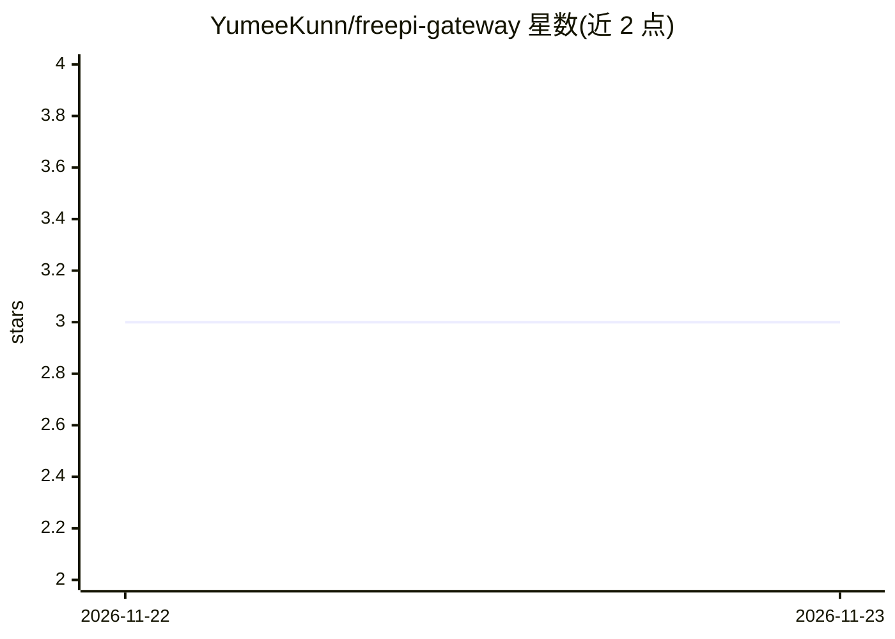

# YumeeKunn/freepi-gateway

⭐ 3 · JavaScript · 推送 2026-11-17 · [GitHub](https://github.com/YumeeKunn/freepi-gateway) · 个人维护

**本地 OpenAI/Anthropic 兼容网关：让任意编码 agent 接入 free-pi**

运行在 free-pi-cli 之前的本地 HTTP 网关，把发往 127.0.0.1:8788 的 OpenAI Chat Completions 与 Anthropic Messages 请求签名后转发到 api.freepi.ai。自身无模型，不绕过 free-pi，每日额度、单会话、广告限制仍然生效。零 npm 依赖，仅用 Node 标准库，需 Node 22.15+ 与已完成的 free-pi GitHub 登录令牌。支持可选 Bearer/x-api-key 鉴权、FIFO 排队、systemd 用户级自启模板；不实现 /v1/responses 端点。

## 筛选速览

| 维度 | 判定 | 备注 |
|---|---|---|
| AI 角色 | `ai-ecosystem` | LLM/agent 周边工具 |
| 许可风险 | `none` | — |
| 部署形态 | `library` | 以包/库形式分发 |
| 模型依赖 | — | README 未给出锁定关系 |
| 硬件要求 | — | 无带数字的原话,不猜 |
| 安装摩擦 | `low` | 无编译、无系统依赖或容器化 |
| 成熟度 | — | 结构信号不足 |

## 能力要点

- 同时提供 OpenAI 与 Anthropic 两种协议端点，任意自定义 base URL 的 agent 可直接接入
- 零依赖单进程，读取本机已有 free-pi 登录令牌并逐请求签名转发
- FIFO 队列序列化上游调用，适配 free tier 单完成并发限制
- 可选 systemd 用户服务模板与 GATEWAY_* 环境变量配置

## 适用场景

- 让 Claude Code、Cline、Aider 等编码 agent 通过本地网关使用 free-pi 模型
- 在 free-pi 单会话限制下排队处理 agent 的并行请求
- 为只支持自定义 OpenAI/Anthropic base URL 的工具提供统一接入点

## 场景标签

`模型网关` · 领域:Agent 开发

## 证据(README 行号)

> L3: Local OpenAI/Anthropic-compatible gateway in front of `free-pi-cli`.
> L10: The gateway has no models of its own and does not bypass free-pi. It signs every
> L14: It speaks two protocols, so **any agent that supports a custom OpenAI base URL

## 星数曲线

2026-11-22 3 → 2026-11-23 3（+0）

---
*卡片 v1 · prompt 1.4 · 生成 2026-11-22 · 置信度 mid · 依据 README sha `00947de57f1e` · [字段定义](../../DATASET.md)*
