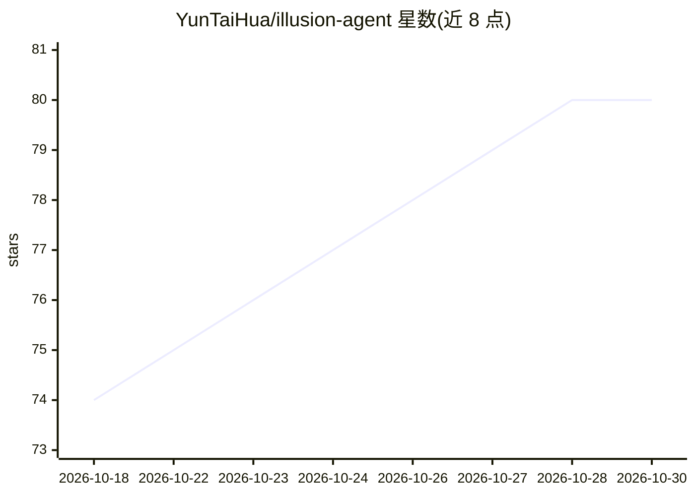

# YunTaiHua/illusion-agent

⭐ 80 · Python · MIT · 推送 2026-10-29 · [GitHub](https://github.com/YunTaiHua/illusion-agent) · [官网](https://github.com/YunTaiHua/illusion-agent/releases/latest) · 个人维护 · 中文 README

**跨终端与浏览器的多模型开源 AI agent 平台**

开源 AI agent 平台，整合多供应商 LLM 网关（Anthropic、OpenAI、Copilot、Codex 及兼容端点）、中英双语 CLI 与 Web UI、插件/技能/MCP/Hooks 扩展生态。内置专用子代理、上下文压缩、cron 定时任务、可驱动的浏览器、权限控制，并可通过飞书/微信/QQ 渠道运行。提供 pip 安装与捆绑运行时的桌面版安装器（Windows/macOS/Linux），源码安装需 Node.js 18+，MIT 许可。

## 筛选速览

| 维度 | 判定 | 备注 |
|---|---|---|
| AI 角色 | `ai-ecosystem` | LLM/agent 周边工具 |
| 许可风险 | `permissive` | MIT |
| 部署形态 | `desktop` | 安装包/桌面程序 |
| 模型依赖 | locked-api |  |
| 硬件要求 | — | 无带数字的原话,不猜 |
| 安装摩擦 | `low` | 无编译、无系统依赖或容器化 |
| 成熟度 | — | 结构信号不足 |

## 能力要点

- 多供应商 LLM 网关（Anthropic/OpenAI/Copilot/Codex 及兼容端点）
- 双语 CLI 与 Web UI 双一等界面，共享同一后端与会话
- 插件/技能/MCP/Hooks 扩展体系与 cron 定时自动化
- 桌面版捆绑 Python 3.12 与 Node.js 24，零环境配置

## 适用场景

- 在终端或浏览器中用同一 agent 处理项目分析与自动化任务
- 通过飞书/微信/QQ 渠道运行无人值守的定时 agent 任务
- 按需接入不同 LLM 供应商并管理权限与上下文压缩

## 场景标签

`Agent 框架` `AI 助手` `浏览器自动化` · 领域:Agent 开发

## 证据(README 行号)

> L11: IllusionAgent is an open-source AI agent platform. It unifies a multi-provider
> L27: - 🤖 **Multi AI Provider Support** - Anthropic, OpenAI, Copilot, Codex, and any compatible endpoint

## 星数曲线

2026-10-18 74 → 2026-10-30 80（+6）

---
*卡片 v1 · prompt 1.4 · 生成 2026-10-24 · 置信度 high · 依据 README sha `cfd8d3ed3040` · [字段定义](../../DATASET.md)*
